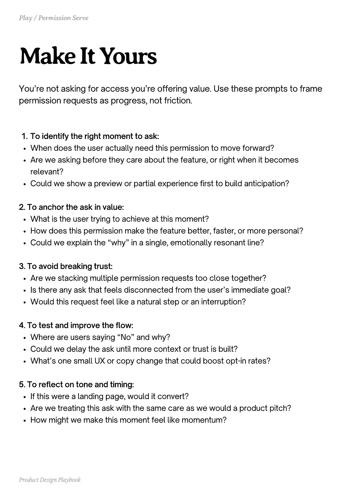

# PDF page 073

Source: `docs/ProductDesignPlaybook_V2.0.pdf`, page 73 of 206.

[Open the full-page screenshot](../../screenshots/page-073.jpg)



## Extracted text

```text
You’re not asking for access you’re offering value. Use these prompts to frame
permission requests as progress, not friction.

To identify the right moment to ask:

When does the user actually need this permission to move forward?

Are we asking before they care about the feature, or right when it becomes
relevant?

Could we show a preview or partial experience first to build anticipation?



2. To anchor the ask in value:

What is the user trying to achieve at this moment?

How does this permission make the feature better, faster, or more personal?

Could we explain the “why” in a single, emotionally resonant line?



3. To avoid breaking trust:

Are we stacking multiple permission requests too close together?

Is there any ask that feels disconnected from the user’s immediate goal?

Would this request feel like a natural step or an interruption?



4. To test and improve the flow:

Where are users saying “No” and why?

Could we delay the ask until more context or trust is built?

What’s one small UX or copy change that could boost opt-in rates?



5. To reflect on tone and timing:

If this were a landing page, would it convert?

Are we treating this ask with the same care as we would a product pitch?

How might we make this moment feel like momentum?

Product Design Playbook
```
