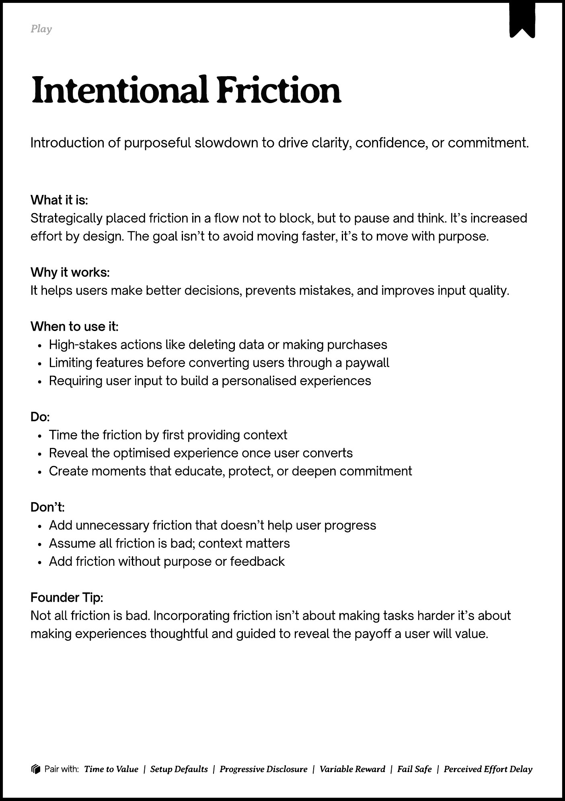

# PDF page 077

Source: `docs/ProductDesignPlaybook_V2.0.pdf`, page 77 of 206.

[Open the full-page screenshot](../../screenshots/page-077.jpg)



## Extracted text

```text
􀉟

Play

Introduction of purposeful slowdown to drive clarity, confidence, or commitment.

What it is:

Strategically placed friction in a flow not to block, but to pause and think. It’s increased
effort by design. The goal isn’t to avoid moving faster, it’s to move with purpose.


Why it works:

It helps users make better decisions, prevents mistakes, and improves input quality.


When to use it:

High-stakes actions like deleting data or making purchases

Limiting features before converting users through a paywall

Requiring user input to build a personalised experiences


Do:

Time the friction by first providing context

Reveal the optimised experience once user converts

Create moments that educate, protect, or deepen commitment


Don’t:

Add unnecessary friction that doesn’t help user progress

Assume all friction is bad; context matters

Add friction without purpose or feedback


Founder Tip:

Not all friction is bad. Incorporating friction isn’t about making tasks harder it’s about
making experiences thoughtful and guided to reveal the payoff a user will value.

􀰴 Pair with:

Time to Value

| Setup Defaults |

Progressive Disclosure

|

Variable Reward

|

Fail Safe

|

Perceived Effort Delay
```
