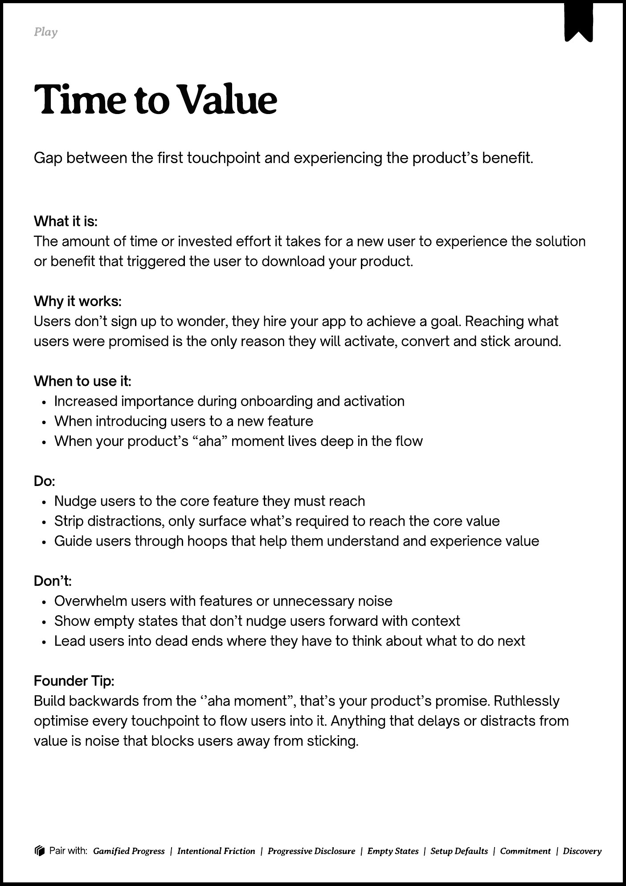

# PDF page 082

Source: `docs/ProductDesignPlaybook_V2.0.pdf`, page 82 of 206.

[Open the full-page screenshot](../../screenshots/page-082.jpg)



## Extracted text

```text
􀉟

Play

Gap between the first touchpoint and experiencing the product’s benefit.

What it is:

The amount of time or invested effort it takes for a new user to experience the solution
or benefit that triggered the user to download your product.


Why it works:

Users don’t sign up to wonder, they hire your app to achieve a goal. Reaching what
users were promised is the only reason they will activate, convert and stick around.


When to use it:

Increased importance during onboarding and activation

When introducing users to a new feature

When your product’s “aha” moment lives deep in the flow


Do:

Nudge users to the core feature they must reach

Strip distractions, only surface what’s required to reach the core value

Guide users through hoops that help them understand and experience value


Don’t:

Overwhelm users with features or unnecessary noise

Show empty states that don’t nudge users forward with context

Lead users into dead ends where they have to think about what to do next


Founder Tip:

Build backwards from the ‘’aha moment”, that’s your product’s promise. Ruthlessly
optimise every touchpoint to flow users into it. Anything that delays or distracts from
value is noise that blocks users away from sticking.

􀰴 Pair with:

Gamified Progress

|

Intentional Friction

|

Progressive Disclosure

|

Empty States

|

Setup Defaults

|

Commitment

|

Discovery
```
