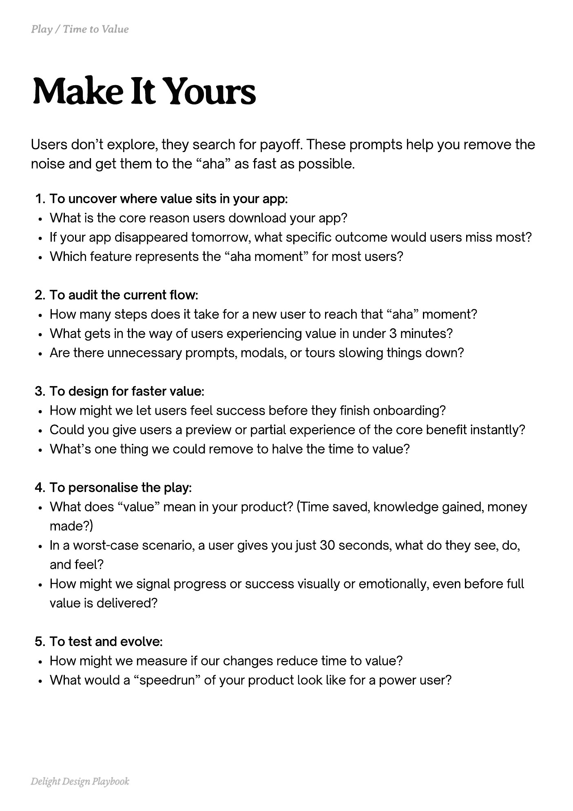

# PDF page 083

Source: `docs/ProductDesignPlaybook_V2.0.pdf`, page 83 of 206.

[Open the full-page screenshot](../../screenshots/page-083.jpg)



## Extracted text

```text
Users don’t explore, they search for payoff. These prompts help you remove the
noise and get them to the “aha” as fast as possible.
To uncover where value sits in your app:

What is the core reason users download your app?

If your app disappeared tomorrow, what specific outcome would users miss most?

Which feature represents the “aha moment” for most users?


To audit the current flow:

How many steps does it take for a new user to reach that “aha” moment?

What gets in the way of users experiencing value in under 3 minutes?

Are there unnecessary prompts, modals, or tours slowing things down?


To design for faster value:

How might we let users feel success before they finish onboarding?

Could you give users a preview or partial experience of the core benefit instantly?

What’s one thing we could remove to halve the time to value?


To personalise the play:

What does “value” mean in your product? (Time saved, knowledge gained, money
made?)

In a worst-case scenario, a user gives you just 30 seconds, what do they see, do,
and feel?

How might we signal progress or success visually or emotionally, even before full
value is delivered?


To test and evolve:

How might we measure if our changes reduce time to value?

What would a “speedrun” of your product look like for a power user?

Delight Design Playbook
```
