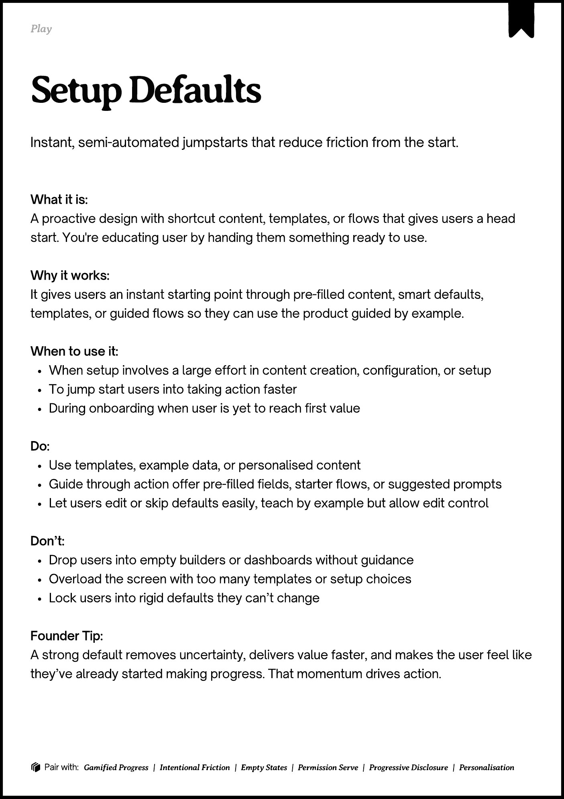

# PDF page 087

Source: `docs/ProductDesignPlaybook_V2.0.pdf`, page 87 of 206.

[Open the full-page screenshot](../../screenshots/page-087.jpg)



## Extracted text

```text
Play

􀉟

Instant, semi-automated jumpstarts that reduce friction from the start.

What it is:

A proactive design with shortcut content, templates, or flows that gives users a head
start. You're educating user by handing them something ready to use.


Why it works:

It gives users an instant starting point through pre-filled content, smart defaults,
templates, or guided flows so they can use the product guided by example.


When to use it:

When setup involves a large effort in content creation, configuration, or setup

To jump start users into taking action faster

During onboarding when user is yet to reach first value


Do:

Use templates, example data, or personalised content

Guide through action offer pre-filled fields, starter flows, or suggested prompts

Let users edit or skip defaults easily, teach by example but allow edit control


Don’t:

Drop users into empty builders or dashboards without guidance

Overload the screen with too many templates or setup choices

Lock users into rigid defaults they can’t change


Founder Tip:

A strong default removes uncertainty, delivers value faster, and makes the user feel like
they’ve already started making progress. That momentum drives action.

􀰴 Pair with: Gamified Progress | Intentional Friction | Empty States | Permission Serve | Progressive Disclosure | Personalisation
```
