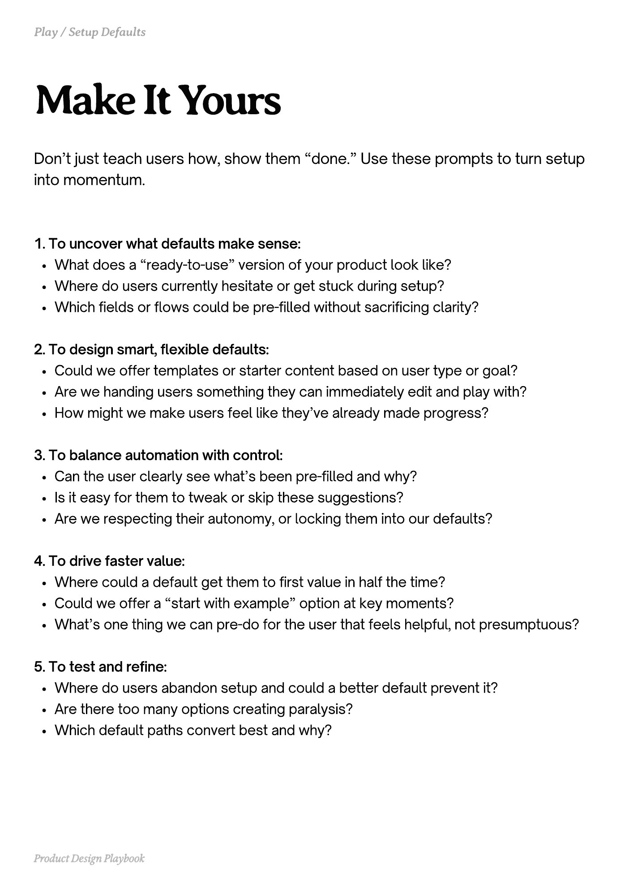

# PDF page 088

Source: `docs/ProductDesignPlaybook_V2.0.pdf`, page 88 of 206.

[Open the full-page screenshot](../../screenshots/page-088.jpg)



## Extracted text

```text
Don’t just teach users how, show them “done.” Use these prompts to turn setup
into momentum.

1. To uncover what defaults make sense:

What does a “ready-to-use” version of your product look like?

Where do users currently hesitate or get stuck during setup?

Which fields or flows could be pre-filled without sacrificing clarity?



2. To design smart, flexible defaults:

Could we offer templates or starter content based on user type or goal?

Are we handing users something they can immediately edit and play with?

How might we make users feel like they’ve already made progress?



3. To balance automation with control:

Can the user clearly see what’s been pre-filled and why?

Is it easy for them to tweak or skip these suggestions?

Are we respecting their autonomy, or locking them into our defaults?



4. To drive faster value:

Where could a default get them to first value in half the time?

Could we offer a “start with example” option at key moments?

What’s one thing we can pre-do for the user that feels helpful, not presumptuous?



5. To test and refine:

Where do users abandon setup and could a better default prevent it?

Are there too many options creating paralysis?

Which default paths convert best and why?

Product Design Playbook
```
