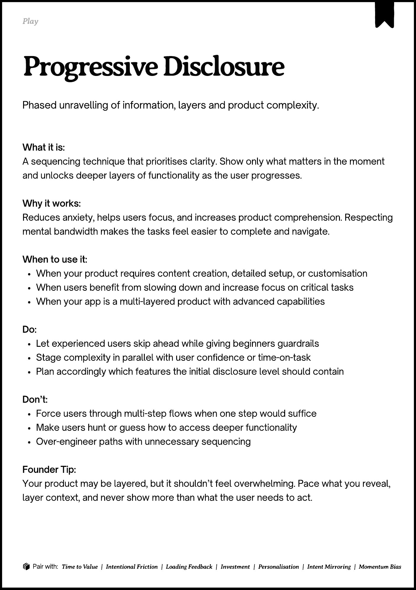

# PDF page 092

Source: `docs/ProductDesignPlaybook_V2.0.pdf`, page 92 of 206.

[Open the full-page screenshot](../../screenshots/page-092.jpg)



## Extracted text

```text
􀉟

Pla

Phased unravelling of information, layers and product complexity.

What it is:

A sequencing technique that prioritises clarity. Show only what matters in the moment
and unlocks deeper layers of functionality as the user progresses.


Why it works:

Reduces anxiety, helps users focus, and increases product comprehension. Respecting
mental bandwidth makes the tasks feel easier to complete and navigate.


When to use it:

When your product requires content creation, detailed setup, or customisation

When users benefit from slowing down and increase focus on critical tasks

When your app is a multi-layered product with advanced capabilities


Do:

Let experienced users skip ahead while giving beginners guardrails

Stage complexity in parallel with user confidence or time-on-task

Plan accordingly which features the initial disclosure level should contain


Don’t:

Force users through multi-step flows when one step would suffice

Make users hunt or guess how to access deeper functionality

Over-engineer paths with unnecessary sequencing


Founder Tip:

Your product may be layered, but it shouldn’t feel overwhelming. Pace what you reveal,
layer context, and never show more than what the user needs to act.

􀰴 Pair with:

Time to Value

|

Intentional Friction

|

Loading Feedback

|

Investment

|

Personalisation

|

Intent Mirroring

|

Momentum Bias
```
