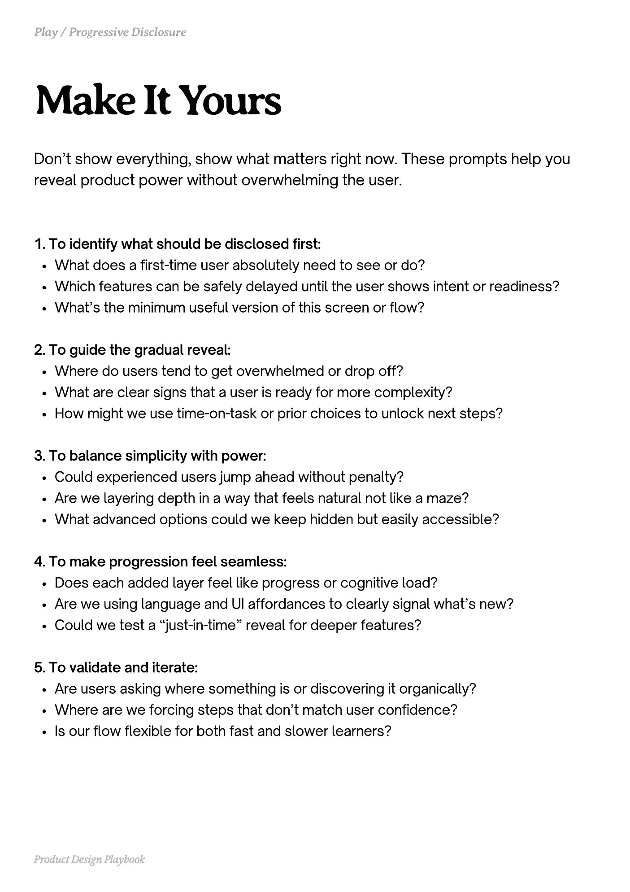

# PDF page 093

Source: `docs/ProductDesignPlaybook_V2.0.pdf`, page 93 of 206.

[Open the full-page screenshot](../../screenshots/page-093.jpg)



## Extracted text

```text
Don’t show everything, show what matters right now. These prompts help you
reveal product power without overwhelming the user.
1. To identify what should be disclosed first:

What does a first-time user absolutely need to see or do?

Which features can be safely delayed until the user shows intent or readiness?

What’s the minimum useful version of this screen or flow?


2. To guide the gradual reveal:

Where do users tend to get overwhelmed or drop off?

What are clear signs that a user is ready for more complexity?

How might we use time-on-task or prior choices to unlock next steps?


3. To balance simplicity with power:

Could experienced users jump ahead without penalty?

Are we layering depth in a way that feels natural not like a maze?

What advanced options could we keep hidden but easily accessible?


4. To make progression feel seamless:

Does each added layer feel like progress or cognitive load?

Are we using language and UI affordances to clearly signal what’s new?

Could we test a “just-in-time” reveal for deeper features?


5. To validate and iterate:

Are users asking where something is or discovering it organically?

Where are we forcing steps that don’t match user confidence?

Is our flow flexible for both fast and slower learners?

Product Design Playbook
```
