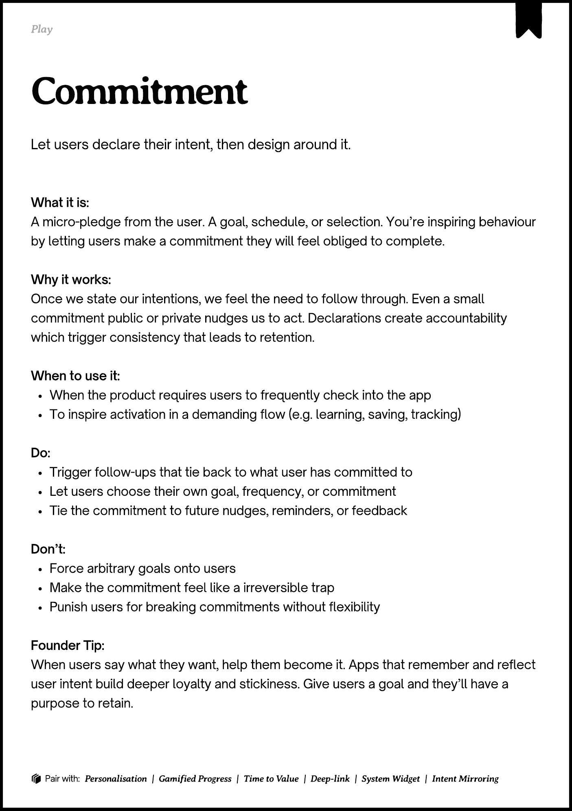

# PDF page 097

Source: `docs/ProductDesignPlaybook_V2.0.pdf`, page 97 of 206.

[Open the full-page screenshot](../../screenshots/page-097.jpg)



## Extracted text

```text
􀉟

Play

Let users declare their intent, then design around it.

What it is:

A micro-pledge from the user. A goal, schedule, or selection. You’re inspiring behaviour
by letting users make a commitment they will feel obliged to complete.


Why it works:

Once we state our intentions, we feel the need to follow through. Even a small
commitment public or private nudges us to act. Declarations create accountability
which trigger consistency that leads to retention.


When to use it:

When the product requires users to frequently check into the app

To inspire activation in a demanding flow (e.g. learning, saving, tracking)


Do:

Trigger follow-ups that tie back to what user has committed to

Let users choose their own goal, frequency, or commitment

Tie the commitment to future nudges, reminders, or feedback


Don’t:

Force arbitrary goals onto users

Make the commitment feel like a irreversible trap

Punish users for breaking commitments without flexibility


Founder Tip:

When users say what they want, help them become it. Apps that remember and reflect
user intent build deeper loyalty and stickiness. Give users a goal and they’ll have a
purpose to retain.

􀰴 Pair with:

Personalisation | Gamified Progress

|

Time to Value

| Deep-link | System Widget |

Intent Mirroring
```
