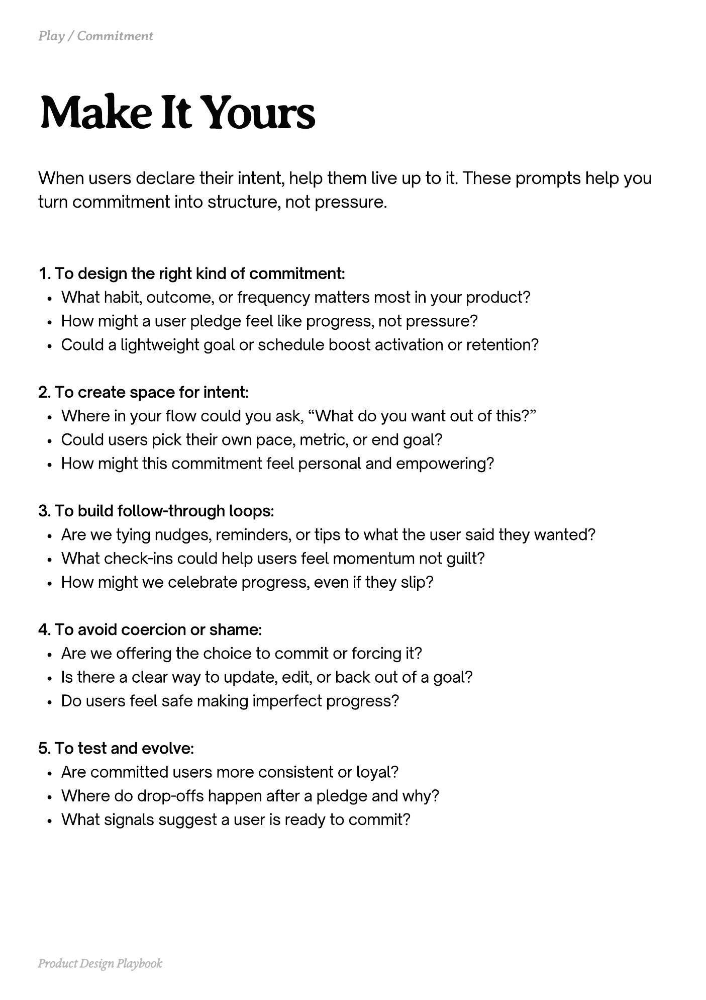

# PDF page 098

Source: `docs/ProductDesignPlaybook_V2.0.pdf`, page 98 of 206.

[Open the full-page screenshot](../../screenshots/page-098.jpg)



## Extracted text

```text
When users declare their intent, help them live up to it. These prompts help you
turn commitment into structure, not pressure.

1. To design the right kind of commitment:

What habit, outcome, or frequency matters most in your product?

How might a user pledge feel like progress, not pressure?

Could a lightweight goal or schedule boost activation or retention?



2. To create space for intent:

Where in your flow could you ask, “What do you want out of this?”

Could users pick their own pace, metric, or end goal?

How might this commitment feel personal and empowering?



3. To build follow-through loops:

Are we tying nudges, reminders, or tips to what the user said they wanted?

What check-ins could help users feel momentum not guilt?

How might we celebrate progress, even if they slip?



4. To avoid coercion or shame:

Are we offering the choice to commit or forcing it?

Is there a clear way to update, edit, or back out of a goal?

Do users feel safe making imperfect progress?



5. To test and evolve:

Are committed users more consistent or loyal?

Where do drop-offs happen after a pledge and why?

What signals suggest a user is ready to commit?

Product Design Playbook
```
