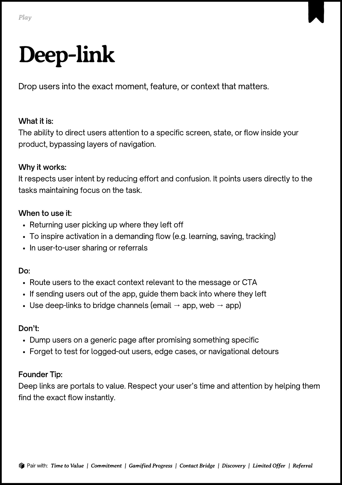

# PDF page 102

Source: `docs/ProductDesignPlaybook_V2.0.pdf`, page 102 of 206.

[Open the full-page screenshot](../../screenshots/page-102.jpg)



## Extracted text

```text
􀉟

Play

Drop users into the exact moment, feature, or context that matters.

What it is:

The ability to direct users attention to a specific screen, state, or flow inside your
product, bypassing layers of navigation.


Why it works:

It respects user intent by reducing effort and confusion. It points users directly to the
tasks maintaining focus on the task.


When to use it:

Returning user picking up where they left off

To inspire activation in a demanding flow (e.g. learning, saving, tracking)

In user-to-user sharing or referrals


Do:

Route users to the exact context relevant to the message or CTA

If sending users out of the app, guide them back into where they left

Use deep-links to bridge channels (email → app, web → app)


Don’t:

Dump users on a generic page after promising something specific

Forget to test for logged-out users, edge cases, or navigational detours


Founder Tip:

Deep links are portals to value. Respect your user’s time and attention by helping them
find the exact flow instantly.

􀰴 Pair with:

Time to Value

| Commitment | Gamified Progress

|

Contact Bridge

| Discovery |

Limited Offer

|

Referral
```
