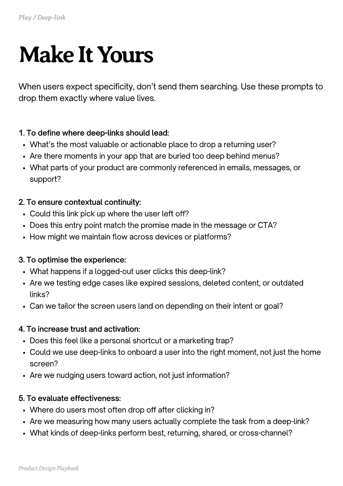

# PDF page 103

Source: `docs/ProductDesignPlaybook_V2.0.pdf`, page 103 of 206.

[Open the full-page screenshot](../../screenshots/page-103.jpg)



## Extracted text

```text
When users expect specificity, don’t send them searching. Use these prompts to
drop them exactly where value lives.

1. To define where deep-links should lead:

What’s the most valuable or actionable place to drop a returning user?

Are there moments in your app that are buried too deep behind menus?

What parts of your product are commonly referenced in emails, messages, or
support?


2. To ensure contextual continuity:

Could this link pick up where the user left off?

Does this entry point match the promise made in the message or CTA?

How might we maintain flow across devices or platforms?


3. To optimise the experience:

What happens if a logged-out user clicks this deep-link?

Are we testing edge cases like expired sessions, deleted content, or outdated
links?

Can we tailor the screen users land on depending on their intent or goal?


4. To increase trust and activation:

Does this feel like a personal shortcut or a marketing trap?

Could we use deep-links to onboard a user into the right moment, not just the home
screen?

Are we nudging users toward action, not just information?


5. To evaluate effectiveness:

Where do users most often drop off after clicking in?

Are we measuring how many users actually complete the task from a deep-link?

What kinds of deep-links perform best, returning, shared, or cross-channel?

Product Design Playbook
```
