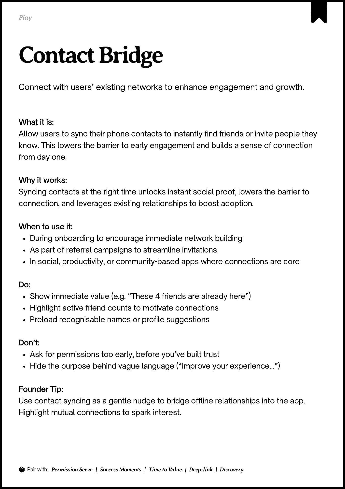

# PDF page 107

Source: `docs/ProductDesignPlaybook_V2.0.pdf`, page 107 of 206.

[Open the full-page screenshot](../../screenshots/page-107.jpg)



## Extracted text

```text
􀉟

Play

Connect with users’ existing networks to enhance engagement and growth.

What it is:

Allow users to sync their phone contacts to instantly find friends or invite people they
know. This lowers the barrier to early engagement and builds a sense of connection
from day one.


Why it works:

Syncing contacts at the right time unlocks instant social proof, lowers the barrier to
connection, and leverages existing relationships to boost adoption.


When to use it:

During onboarding to encourage immediate network building

As part of referral campaigns to streamline invitations

In social, productivity, or community-based apps where connections are core


Do:

Show immediate value (e.g. “These 4 friends are already here”)

Highlight active friend counts to motivate connections

Preload recognisable names or profile suggestions


Don’t:

Ask for permissions too early, before you’ve built trust

Hide the purpose behind vague language (“Improve your experience…”)


Founder Tip:

Use contact syncing as a gentle nudge to bridge offline relationships into the app.
Highlight mutual connections to spark interest.

􀰴 Pair with:

Permission Serve

|

Success Moments

|

Time to Value

| Deep-link | Discovery
```
