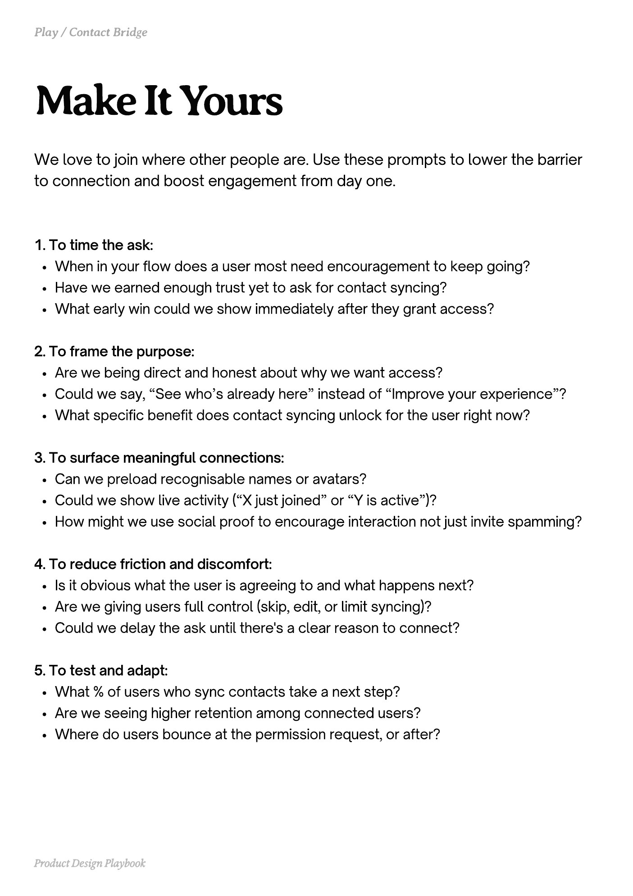

# PDF page 108

Source: `docs/ProductDesignPlaybook_V2.0.pdf`, page 108 of 206.

[Open the full-page screenshot](../../screenshots/page-108.jpg)



## Extracted text

```text
We love to join where other people are. Use these prompts to lower the barrier
to connection and boost engagement from day one.

1. To time the ask:

When in your flow does a user most need encouragement to keep going?

Have we earned enough trust yet to ask for contact syncing?

What early win could we show immediately after they grant access?



2. To frame the purpose:

Are we being direct and honest about why we want access?

Could we say, “See who’s already here” instead of “Improve your experience”?

What specific benefit does contact syncing unlock for the user right now?



3. To surface meaningful connections:

Can we preload recognisable names or avatars?

Could we show live activity (“X just joined” or “Y is active”)?

How might we use social proof to encourage interaction not just invite spamming?



4. To reduce friction and discomfort:

Is it obvious what the user is agreeing to and what happens next?

Are we giving users full control (skip, edit, or limit syncing)?

Could we delay the ask until there's a clear reason to connect?



5. To test and adapt:

What % of users who sync contacts take a next step?

Are we seeing higher retention among connected users?

Where do users bounce at the permission request, or after?

Product Design Playbook
```
