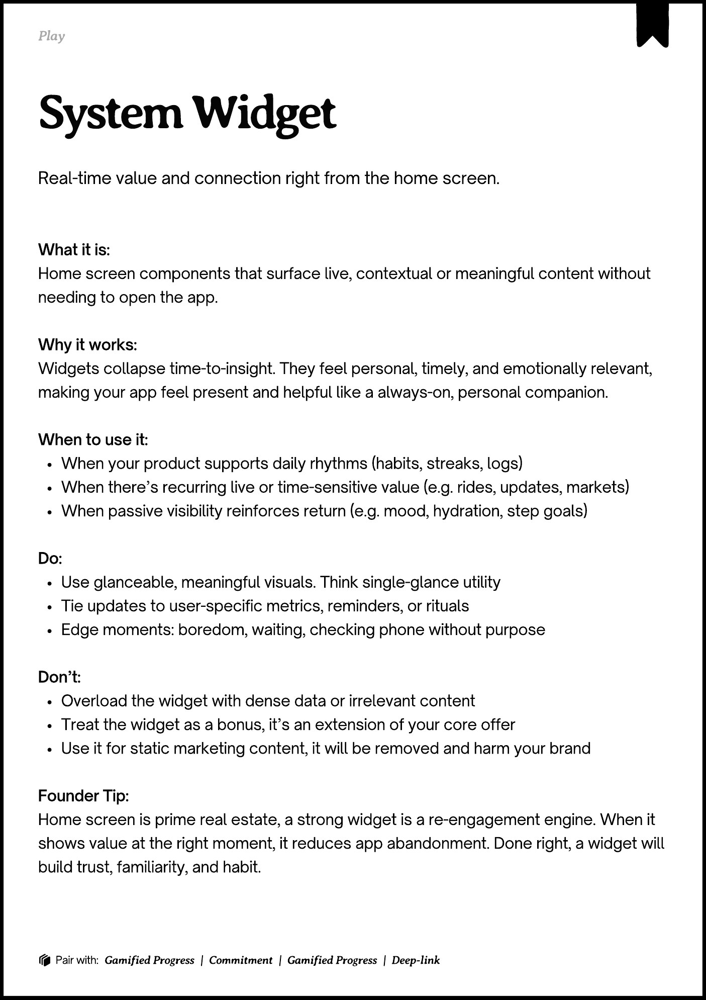

# PDF page 112

Source: `docs/ProductDesignPlaybook_V2.0.pdf`, page 112 of 206.

[Open the full-page screenshot](../../screenshots/page-112.jpg)



## Extracted text

```text
􀉟

Pla

Real-time value and connection right from the home screen.

What it is:

Home screen components that surface live, contextual or meaningful content without
needing to open the app.


Why it works:

Widgets collapse time-to-insight. They feel personal, timely, and emotionally relevant,
making your app feel present and helpful like a always-on, personal companion.


When to use it:

When your product supports daily rhythms (habits, streaks, logs)

When there’s recurring live or time-sensitive value (e.g. rides, updates, markets)

When passive visibility reinforces return (e.g. mood, hydration, step goals)


Do:

Use glanceable, meaningful visuals. Think single-glance utility

Tie updates to user-specific metrics, reminders, or rituals

Edge moments: boredom, waiting, checking phone without purpose


Don’t:

Overload the widget with dense data or irrelevant content

Treat the widget as a bonus, it’s an extension of your core offer

Use it for static marketing content, it will be removed and harm your brand


Founder Tip:

Home screen is prime real estate, a strong widget is a re-engagement engine. When it
shows value at the right moment, it reduces app abandonment. Done right, a widget will
build trust, familiarity, and habit.

􀰴 Pair with: Gamified Progress | Commitment | Gamified Progress | Deep-link
```
