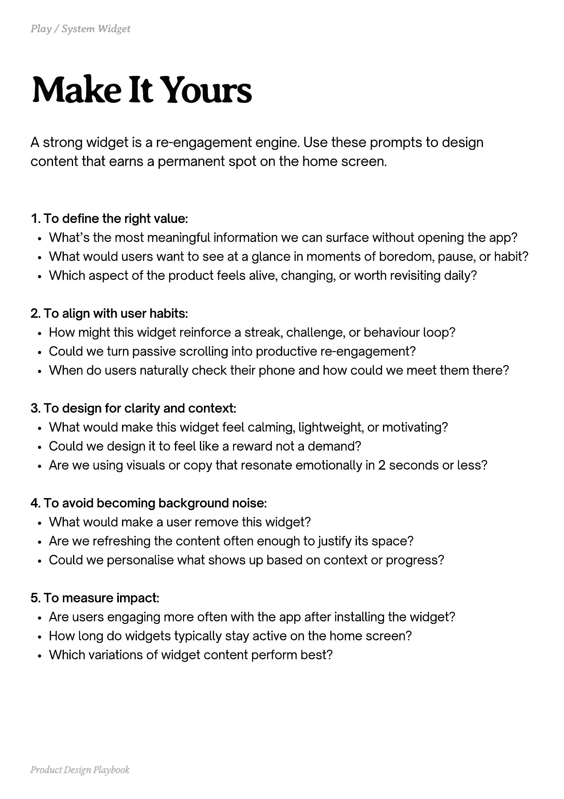

# PDF page 113

Source: `docs/ProductDesignPlaybook_V2.0.pdf`, page 113 of 206.

[Open the full-page screenshot](../../screenshots/page-113.jpg)



## Extracted text

```text
A strong widget is a re-engagement engine. Use these prompts to design
content that earns a permanent spot on the home screen.
1. To define the right value:

What’s the most meaningful information we can surface without opening the app?

What would users want to see at a glance in moments of boredom, pause, or habit?

Which aspect of the product feels alive, changing, or worth revisiting daily?


2. To align with user habits:

How might this widget reinforce a streak, challenge, or behaviour loop?

Could we turn passive scrolling into productive re-engagement?

When do users naturally check their phone and how could we meet them there?


3. To design for clarity and context:

What would make this widget feel calming, lightweight, or motivating?

Could we design it to feel like a reward not a demand?

Are we using visuals or copy that resonate emotionally in 2 seconds or less?


4. To avoid becoming background noise:

What would make a user remove this widget?

Are we refreshing the content often enough to justify its space?

Could we personalise what shows up based on context or progress?


5. To measure impact:

Are users engaging more often with the app after installing the widget?

How long do widgets typically stay active on the home screen?

Which variations of widget content perform best?

Product Design Playbook
```
