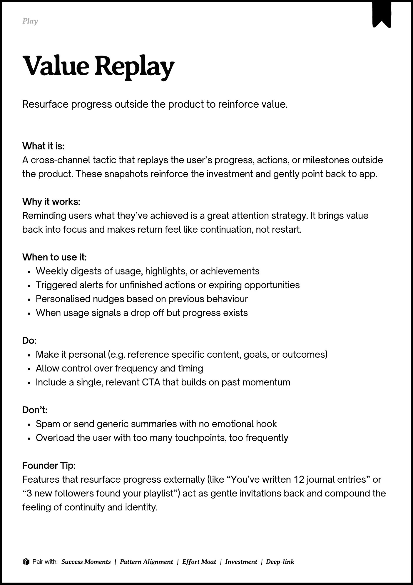

# PDF page 117

Source: `docs/ProductDesignPlaybook_V2.0.pdf`, page 117 of 206.

[Open the full-page screenshot](../../screenshots/page-117.jpg)



## Extracted text

```text
􀉟

Pla

Resurface progress outside the product to reinforce value.

What it is:

A cross-channel tactic that replays the user’s progress, actions, or milestones outside
the product. These snapshots reinforce the investment and gently point back to app.


Why it works:

Reminding users what they’ve achieved is a great attention strategy. It brings value
back into focus and makes return feel like continuation, not restart.


When to use it:

Weekly digests of usage, highlights, or achievements

Triggered alerts for unfinished actions or expiring opportunities

Personalised nudges based on previous behaviour

When usage signals a drop off but progress exists


Do:

Make it personal (e.g. reference specific content, goals, or outcomes)

Allow control over frequency and timing

Include a single, relevant CTA that builds on past momentum


Don’t:

Spam or send generic summaries with no emotional hook

Overload the user with too many touchpoints, too frequently


Founder Tip:

Features that resurface progress externally (like “You’ve written 12 journal entries” or
“3 new followers found your playlist”) act as gentle invitations back and compound the
feeling of continuity and identity.

􀰴 Pair with:

Success Moments

|

Pattern Alignment

|

Effort Moat

|

Investment

| Deep-link
```
