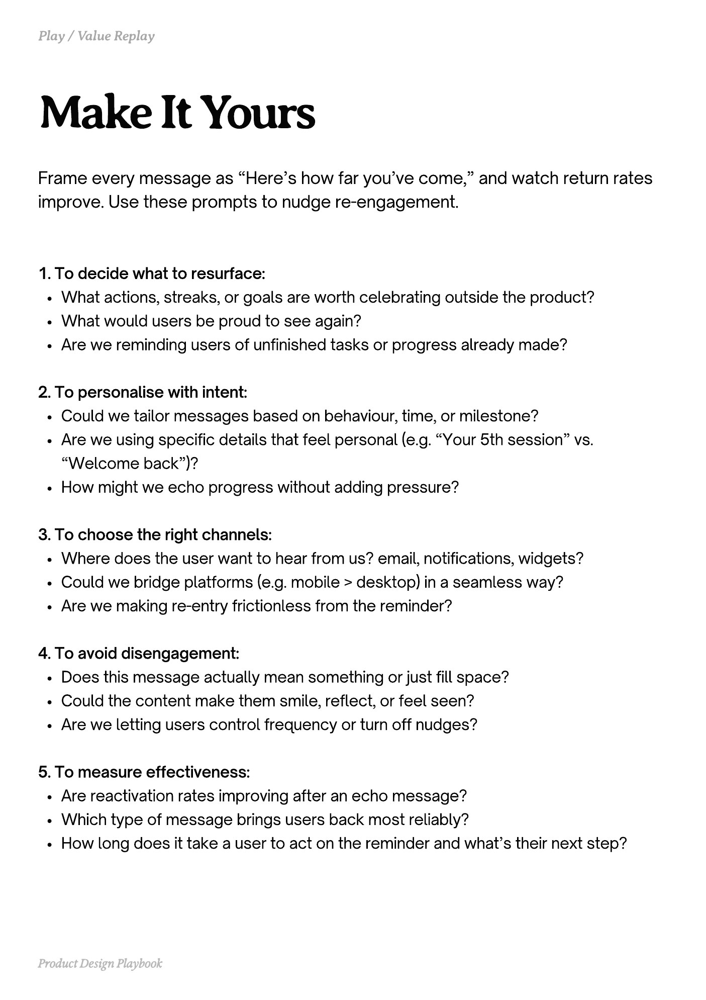

# PDF page 118

Source: `docs/ProductDesignPlaybook_V2.0.pdf`, page 118 of 206.

[Open the full-page screenshot](../../screenshots/page-118.jpg)



## Extracted text

```text
Frame every message as “Here’s how far you’ve come,” and watch return rates
improve. Use these prompts to nudge re-engagement.
1. To decide what to resurface:

What actions, streaks, or goals are worth celebrating outside the product?

What would users be proud to see again?

Are we reminding users of unfinished tasks or progress already made?


2. To personalise with intent:

Could we tailor messages based on behaviour, time, or milestone?

Are we using specific details that feel personal (e.g. “Your 5th session” vs.
“Welcome back”)?

How might we echo progress without adding pressure?


3. To choose the right channels:

Where does the user want to hear from us? email, notifications, widgets?

Could we bridge platforms (e.g. mobile > desktop) in a seamless way?

Are we making re-entry frictionless from the reminder?


4. To avoid disengagement:

Does this message actually mean something or just fill space?

Could the content make them smile, reflect, or feel seen?

Are we letting users control frequency or turn off nudges?


5. To measure effectiveness:

Are reactivation rates improving after an echo message?

Which type of message brings users back most reliably?

How long does it take a user to act on the reminder and what’s their next step?

Product Design Playbook
```
