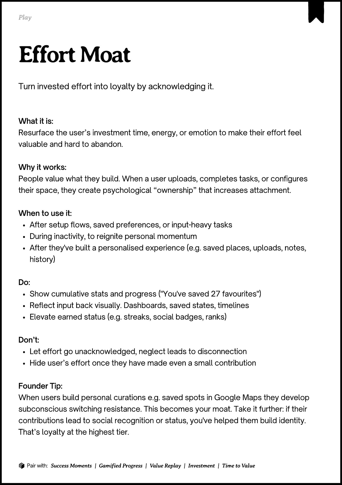

# PDF page 122

Source: `docs/ProductDesignPlaybook_V2.0.pdf`, page 122 of 206.

[Open the full-page screenshot](../../screenshots/page-122.jpg)



## Extracted text

```text
􀉟

Play

Turn invested effort into loyalty by acknowledging it.

What it is:

Resurface the user’s investment time, energy, or emotion to make their effort feel
valuable and hard to abandon.


Why it works:

People value what they build. When a user uploads, completes tasks, or configures
their space, they create psychological “ownership” that increases attachment.


When to use it:

After setup flows, saved preferences, or input-heavy tasks

During inactivity, to reignite personal momentum

After they've built a personalised experience (e.g. saved places, uploads, notes,
history)


Do:

Show cumulative stats and progress ("You've saved 27 favourites")

Reflect input back visually. Dashboards, saved states, timelines

Elevate earned status (e.g. streaks, social badges, ranks)


Don’t:

Let effort go unacknowledged, neglect leads to disconnection

Hide user’s effort once they have made even a small contribution


Founder Tip:

When users build personal curations e.g. saved spots in Google Maps they develop
subconscious switching resistance. This becomes your moat. Take it further: if their
contributions lead to social recognition or status, you've helped them build identity.
That’s loyalty at the highest tier.

􀰴 Pair with:

Success Moments

| Gamified Progress

|

Value Replay

|

Investment

|

Time to Value
```
