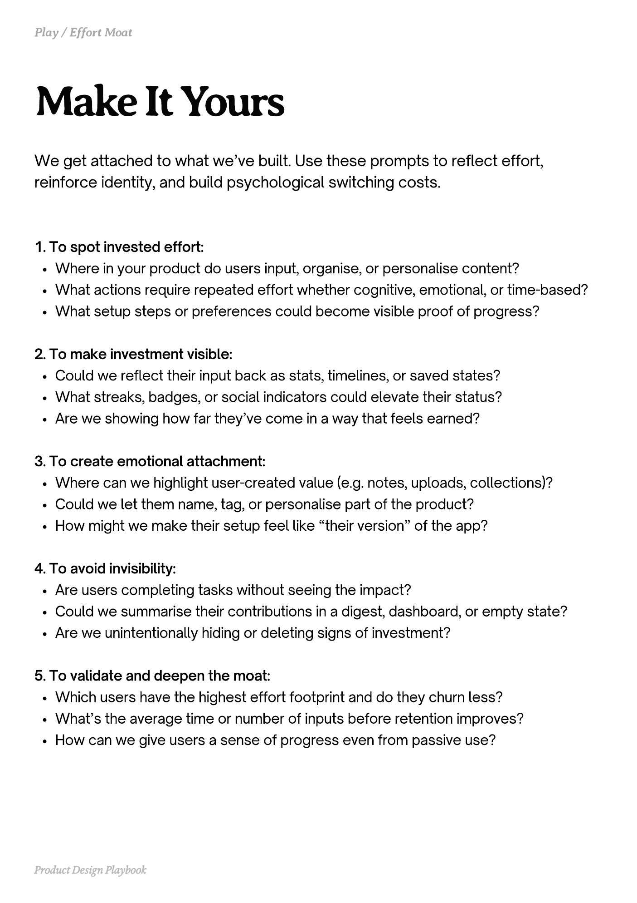

# PDF page 123

Source: `docs/ProductDesignPlaybook_V2.0.pdf`, page 123 of 206.

[Open the full-page screenshot](../../screenshots/page-123.jpg)



## Extracted text

```text
We get attached to what we’ve built. Use these prompts to reflect effort,
reinforce identity, and build psychological switching costs.

1. To spot invested effort:

Where in your product do users input, organise, or personalise content?

What actions require repeated effort whether cognitive, emotional, or time-based?

What setup steps or preferences could become visible proof of progress?



2. To make investment visible:

Could we reflect their input back as stats, timelines, or saved states?

What streaks, badges, or social indicators could elevate their status?

Are we showing how far they’ve come in a way that feels earned?



3. To create emotional attachment:

Where can we highlight user-created value (e.g. notes, uploads, collections)?

Could we let them name, tag, or personalise part of the product?

How might we make their setup feel like “their version” of the app?



4. To avoid invisibility:

Are users completing tasks without seeing the impact?

Could we summarise their contributions in a digest, dashboard, or empty state?

Are we unintentionally hiding or deleting signs of investment?



5. To validate and deepen the moat:

Which users have the highest effort footprint and do they churn less?

What’s the average time or number of inputs before retention improves?

How can we give users a sense of progress even from passive use?

Product Design Playbook
```
