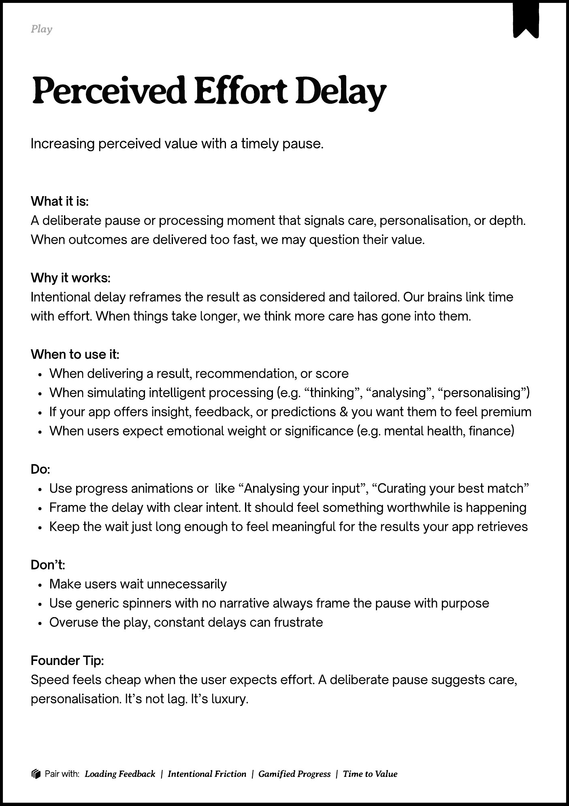

# PDF page 127

Source: `docs/ProductDesignPlaybook_V2.0.pdf`, page 127 of 206.

[Open the full-page screenshot](../../screenshots/page-127.jpg)



## Extracted text

```text
􀉟

Pla

Increasing perceived value with a timely pause.

What it is:

A deliberate pause or processing moment that signals care, personalisation, or depth.
When outcomes are delivered too fast, we may question their value.


Why it works:

Intentional delay reframes the result as considered and tailored. Our brains link time
with effort. When things take longer, we think more care has gone into them.


When to use it:

When delivering a result, recommendation, or score

When simulating intelligent processing (e.g. “thinking”, “analysing”, “personalising”)

If your app offers insight, feedback, or predictions & you want them to feel premium

When users expect emotional weight or significance (e.g. mental health, finance)


Do:

Use progress animations or

like “Analysing your input”, “Curating your best match”


Frame the delay with clear intent. It should feel something worthwhile is happening

Keep the wait just long enough to feel meaningful for the results your app retrieves


Don’t:

Make users wait unnecessarily

Use generic spinners with no narrative always frame the pause with purpose

Overuse the play, constant delays can frustrate


Founder Tip:

Speed feels cheap when the user expects effort. A deliberate pause suggests care,
personalisation. It’s not lag. It’s luxury.

􀰴 Pair with:

Loading Feedback

|

Intentional Friction

| Gamified Progress

|

Time to Value
```
