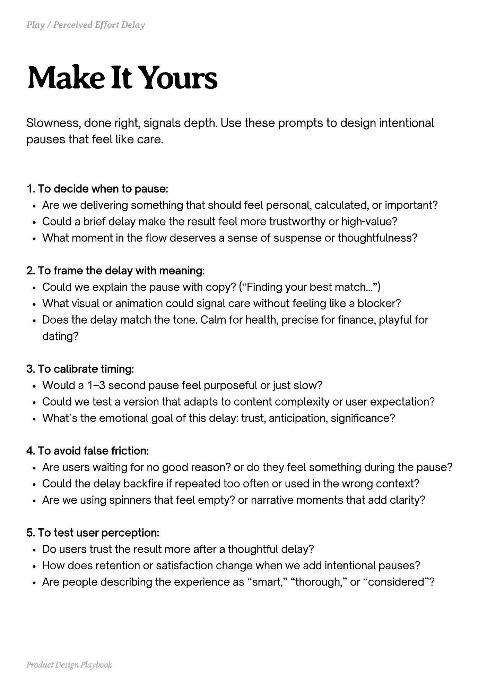

# PDF page 128

Source: `docs/ProductDesignPlaybook_V2.0.pdf`, page 128 of 206.

[Open the full-page screenshot](../../screenshots/page-128.jpg)



## Extracted text

```text
Slowness, done right, signals depth. Use these prompts to design intentional
pauses that feel like care.
1. To decide when to pause:

Are we delivering something that should feel personal, calculated, or important?

Could a brief delay make the result feel more trustworthy or high-value?

What moment in the flow deserves a sense of suspense or thoughtfulness?


2. To frame the delay with meaning:

Could we explain the pause with copy? (“Finding your best match...”)

What visual or animation could signal care without feeling like a blocker?

Does the delay match the tone. Calm for health, precise for finance, playful for
dating?


3. To calibrate timing:

Would a 1-3 second pause feel purposeful or just slow?

Could we test a version that adapts to content complexity or user expectation?

What’s the emotional goal of this delay: trust, anticipation, significance?


4. To avoid false friction:

Are users waiting for no good reason? or do they feel something during the pause?

Could the delay backfire if repeated too often or used in the wrong context?

Are we using spinners that feel empty? or narrative moments that add clarity?


5. To test user perception:

Do users trust the result more after a thoughtful delay?

How does retention or satisfaction change when we add intentional pauses?

Are people describing the experience as “smart,” “thorough,” or “considered”?

Product Design Playbook
```
