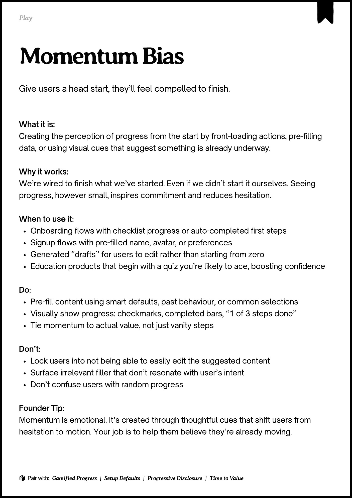

# PDF page 132

Source: `docs/ProductDesignPlaybook_V2.0.pdf`, page 132 of 206.

[Open the full-page screenshot](../../screenshots/page-132.jpg)



## Extracted text

```text
􀉟

Pla

Give users a head start, they’ll feel compelled to finish.

What it is:

Creating the perception of progress from the start by front-loading actions, pre-filling
data, or using visual cues that suggest something is already underway.


Why it works:

We’re wired to finish what we’ve started. Even if we didn’t start it ourselves. Seeing
progress, however small, inspires commitment and reduces hesitation.


When to use it:

Onboarding flows with checklist progress or auto-completed first steps

Signup flows with pre-filled name, avatar, or preferences

Generated “drafts” for users to edit rather than starting from zero

Education products that begin with a quiz you’re likely to ace, boosting confidence


Do:

Pre-fill content using smart defaults, past behaviour, or common selections

Visually show progress: checkmarks, completed bars, “1 of 3 steps done”

Tie momentum to actual value, not just vanity steps


Don’t:

Lock users into not being able to easily edit the suggested content

Surface irrelevant filler that don’t resonate with user’s intent

Don’t confuse users with random progress


Founder Tip:

Momentum is emotional. It’s created through thoughtful cues that shift users from
hesitation to motion. Your job is to help them believe they’re already moving.

􀰴 Pair with:

Gamified Progress

| Setup Defaults |

Progressive Disclosure

|

Time to Value
```
