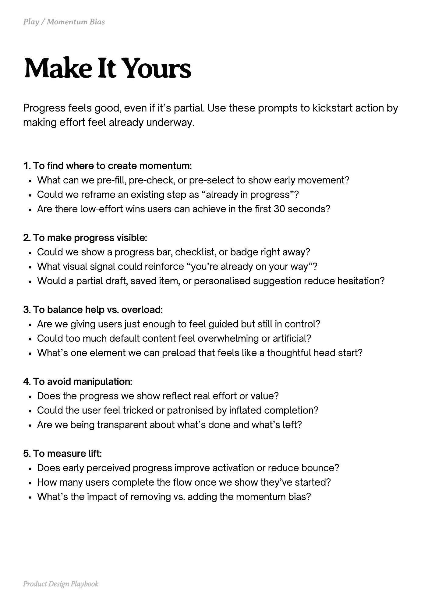

# PDF page 133

Source: `docs/ProductDesignPlaybook_V2.0.pdf`, page 133 of 206.

[Open the full-page screenshot](../../screenshots/page-133.jpg)



## Extracted text

```text
Progress feels good, even if it’s partial. Use these prompts to kickstart action by
making effort feel already underway.
1. To find where to create momentum:

What can we pre-fill, pre-check, or pre-select to show early movement?

Could we reframe an existing step as “already in progress”?

Are there low-effort wins users can achieve in the first 30 seconds?


2. To make progress visible:

Could we show a progress bar, checklist, or badge right away?

What visual signal could reinforce “you’re already on your way”?

Would a partial draft, saved item, or personalised suggestion reduce hesitation?


3. To balance help vs. overload:

Are we giving users just enough to feel guided but still in control?

Could too much default content feel overwhelming or artificial?

What’s one element we can preload that feels like a thoughtful head start?


4. To avoid manipulation:

Does the progress we show reflect real effort or value?

Could the user feel tricked or patronised by inflated completion?

Are we being transparent about what’s done and what’s left?


5. To measure lift:

Does early perceived progress improve activation or reduce bounce?

How many users complete the flow once we show they’ve started?

What’s the impact of removing vs. adding the momentum bias?

Product Design Playbook
```
