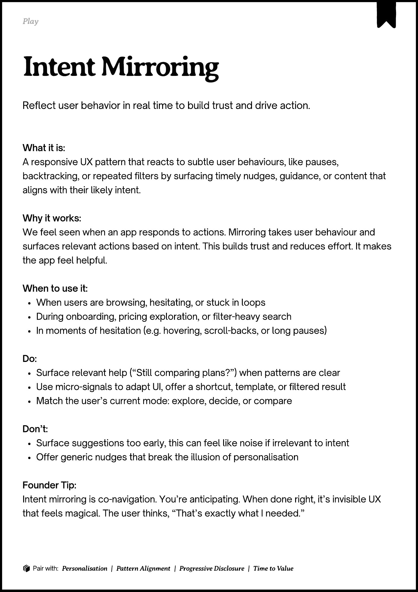

# PDF page 137

Source: `docs/ProductDesignPlaybook_V2.0.pdf`, page 137 of 206.

[Open the full-page screenshot](../../screenshots/page-137.jpg)



## Extracted text

```text
􀉟

Pla

Reflect user behavior in real time to build trust and drive action.

What it is:

A responsive UX pattern that reacts to subtle user behaviours, like pauses,
backtracking, or repeated filters by surfacing timely nudges, guidance, or content that
aligns with their likely intent.


Why it works:

We feel seen when an app responds to actions. Mirroring takes user behaviour and
surfaces relevant actions based on intent. This builds trust and reduces effort. It makes
the app feel helpful.


When to use it:

When users are browsing, hesitating, or stuck in loops

During onboarding, pricing exploration, or filter-heavy search

In moments of hesitation (e.g. hovering, scroll-backs, or long pauses)


Do:

Surface relevant help (“Still comparing plans?”) when patterns are clear

Use micro-signals to adapt UI, offer a shortcut, template, or filtered result

Match the user’s current mode: explore, decide, or compare


Don’t:

Surface suggestions too early, this can feel like noise if irrelevant to intent

Offer generic nudges that break the illusion of personalisation


Founder Tip:

Intent mirroring is co-navigation. You’re anticipating. When done right, it’s invisible UX
that feels magical. The user thinks, “That’s exactly what I needed.”

􀰴 Pair with:

Personalisation |

Pattern Alignment

|

Progressive Disclosure

|

Time to Value
```
