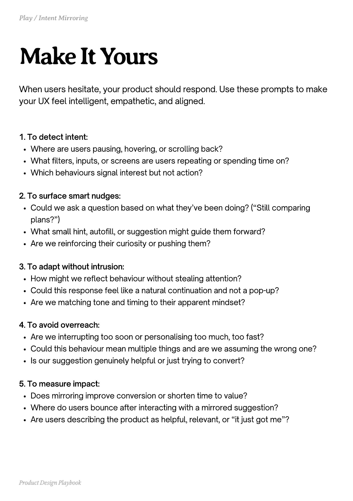

# PDF page 138

Source: `docs/ProductDesignPlaybook_V2.0.pdf`, page 138 of 206.

[Open the full-page screenshot](../../screenshots/page-138.jpg)



## Extracted text

```text
When users hesitate, your product should respond. Use these prompts to make
your UX feel intelligent, empathetic, and aligned.
1. To detect intent:

Where are users pausing, hovering, or scrolling back?

What filters, inputs, or screens are users repeating or spending time on?

Which behaviours signal interest but not action?


2. To surface smart nudges:

Could we ask a question based on what they’ve been doing? (“Still comparing
plans?”)

What small hint, autofill, or suggestion might guide them forward?

Are we reinforcing their curiosity or pushing them?


3. To adapt without intrusion:

How might we reflect behaviour without stealing attention?

Could this response feel like a natural continuation and not a pop-up?

Are we matching tone and timing to their apparent mindset?


4. To avoid overreach:

Are we interrupting too soon or personalising too much, too fast?

Could this behaviour mean multiple things and are we assuming the wrong one?

Is our suggestion genuinely helpful or just trying to convert?


5. To measure impact:

Does mirroring improve conversion or shorten time to value?

Where do users bounce after interacting with a mirrored suggestion?

Are users describing the product as helpful, relevant, or “it just got me”?

Product Design Playbook
```
