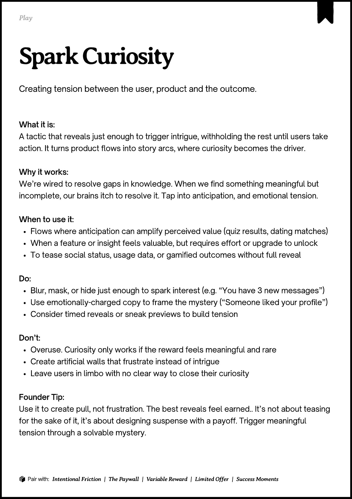

# PDF page 142

Source: `docs/ProductDesignPlaybook_V2.0.pdf`, page 142 of 206.

[Open the full-page screenshot](../../screenshots/page-142.jpg)



## Extracted text

```text
􀉟

Play

Creating tension between the user, product and the outcome.

What it is:

A tactic that reveals just enough to trigger intrigue, withholding the rest until users take
action. It turns product flows into story arcs, where curiosity becomes the driver.


Why it works:

We’re wired to resolve gaps in knowledge. When we find something meaningful but
incomplete, our brains itch to resolve it. Tap into anticipation, and emotional tension.


When to use it:

Flows where anticipation can amplify perceived value (quiz results, dating matches)

When a feature or insight feels valuable, but requires effort or upgrade to unlock

To tease social status, usage data, or gamified outcomes without full reveal


Do:

Blur, mask, or hide just enough to spark interest (e.g. “You have 3 new messages”)

Use emotionally-charged copy to frame the mystery (“Someone liked your profile”)

Consider timed reveals or sneak previews to build tension


Don’t:

Overuse. Curiosity only works if the reward feels meaningful and rare

Create artificial walls that frustrate instead of intrigue

Leave users in limbo with no clear way to close their curiosity


Founder Tip:

Use it to create pull, not frustration. The best reveals feel earned.. It’s not about teasing
for the sake of it, it’s about designing suspense with a payoff. Trigger meaningful
tension through a solvable mystery.

􀰴 Pair with:

Intentional Friction

|

The Paywall

|

Variable Reward

|

Limited Offer

|

Success Moments
```
