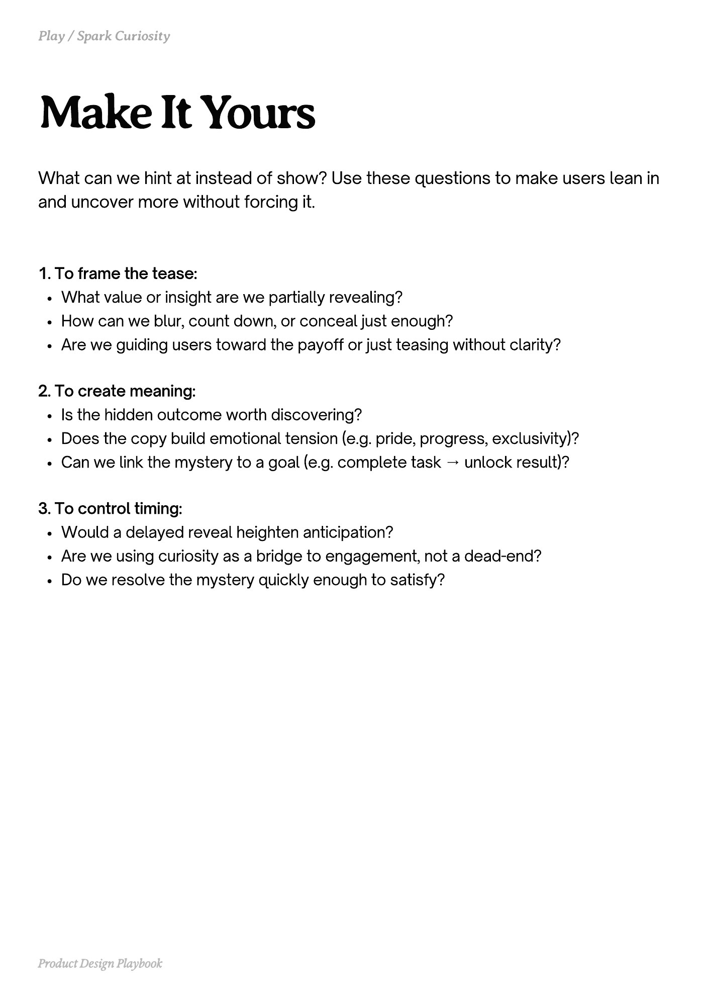

# PDF page 143

Source: `docs/ProductDesignPlaybook_V2.0.pdf`, page 143 of 206.

[Open the full-page screenshot](../../screenshots/page-143.jpg)



## Extracted text

```text
What can we hint at instead of show? Use these questions to make users lean in
and uncover more without forcing it.
1. To frame the tease:

What value or insight are we partially revealing?

How can we blur, count down, or conceal just enough?

Are we guiding users toward the payoff or just teasing without clarity?


2. To create meaning:

Is the hidden outcome worth discovering?

Does the copy build emotional tension (e.g. pride, progress, exclusivity)?

Can we link the mystery to a goal (e.g. complete task → unlock result)?


3. To control timing:

Would a delayed reveal heighten anticipation?

Are we using curiosity as a bridge to engagement, not a dead-end?

Do we resolve the mystery quickly enough to satisfy?

Product Design Playbook
```
