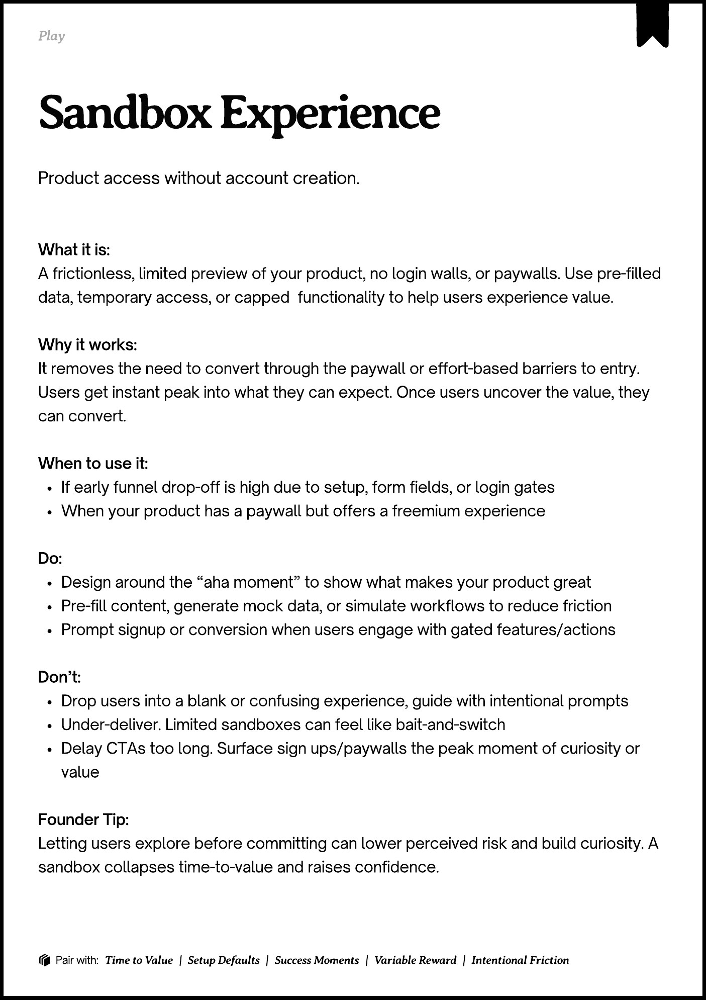

# PDF page 147

Source: `docs/ProductDesignPlaybook_V2.0.pdf`, page 147 of 206.

[Open the full-page screenshot](../../screenshots/page-147.jpg)



## Extracted text

```text
􀉟

la

Product access without account creation.

What it is:

A frictionless, limited preview of your product, no login walls, or paywalls. Use pre-filled
data, temporary access, or capped

functionality to help users experience value.


Why it works:

It removes the need to convert through the paywall or effort-based barriers to entry.
Users get instant peak into what they can expect. Once users uncover the value, they
can convert.


When to use it:

If early funnel drop-off is high due to setup, form fields, or login gates

When your product has a paywall but offers a freemium experience 


Do:

Design around the “aha moment” to show what makes your product great

Pre-fill content, generate mock data, or simulate workflows to reduce friction

Prompt signup or conversion when users engage with gated features/actions


Don’t:

Drop users into a blank or confusing experience, guide with intentional prompts

Under-deliver. Limited sandboxes can feel like bait-and-switch

Delay CTAs too long. Surface sign ups/paywalls the peak moment of curiosity or
value


Founder Tip:

Letting users explore before committing can lower perceived risk and build curiosity. A
sandbox collapses time-to-value and raises confidence.

􀰴 Pair with:

Time to Value

| Setup Defaults |

Success Moments

|

Variable Reward

|

Intentional Friction
```
