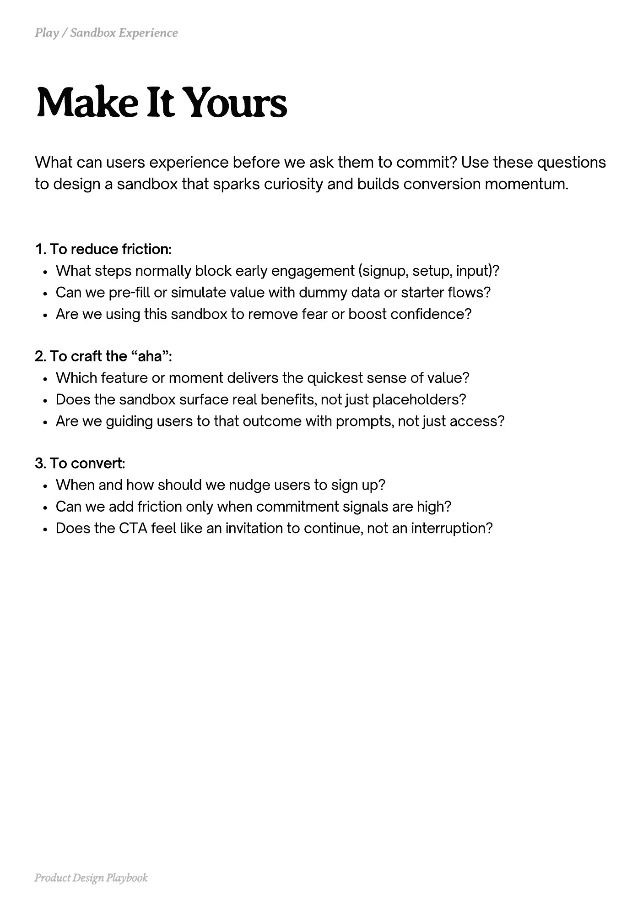

# PDF page 148

Source: `docs/ProductDesignPlaybook_V2.0.pdf`, page 148 of 206.

[Open the full-page screenshot](../../screenshots/page-148.jpg)



## Extracted text

```text
What can users experience before we ask them to commit? Use these questions
to design a sandbox that sparks curiosity and builds conversion momentum.

1. To reduce friction:

What steps normally block early engagement (signup, setup, input)?

Can we pre-fill or simulate value with dummy data or starter flows?

Are we using this sandbox to remove fear or boost confidence?


2. To craft the “aha”:

Which feature or moment delivers the quickest sense of value?

Does the sandbox surface real benefits, not just placeholders?

Are we guiding users to that outcome with prompts, not just access?


3. To convert:

When and how should we nudge users to sign up?

Can we add friction only when commitment signals are high?

Does the CTA feel like an invitation to continue, not an interruption?

Product Design Playbook
```
