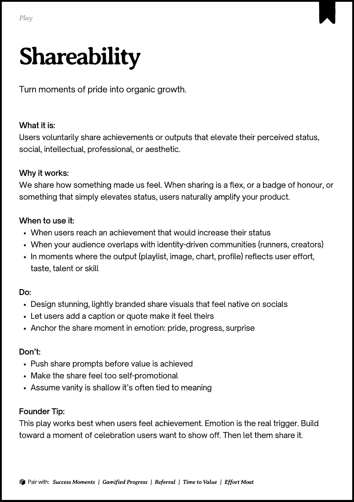

# PDF page 152

Source: `docs/ProductDesignPlaybook_V2.0.pdf`, page 152 of 206.

[Open the full-page screenshot](../../screenshots/page-152.jpg)



## Extracted text

```text
􀉟

Pla

Turn moments of pride into organic growth.

What it is:

Users voluntarily share achievements or outputs that elevate their perceived status,
social, intellectual, professional, or aesthetic. 


Why it works:

We share how something made us feel. When sharing is a flex, or a badge of honour, or
something that simply elevates status, users naturally amplify your product.


When to use it:

When users reach an achievement that would increase their status

When your audience overlaps with identity-driven communities (runners, creators)

In moments where the output (playlist, image, chart, profile) reflects user effort,
taste, talent or skill


Do:

Design stunning, lightly branded share visuals that feel native on socials

Let users add a caption or quote make it feel theirs

Anchor the share moment in emotion: pride, progress, surprise


Don’t:

Push share prompts before value is achieved

Make the share feel too self-promotional

Assume vanity is shallow it’s often tied to meaning


Founder Tip:

This play works best when users feel achievement. Emotion is the real trigger. Build
toward a moment of celebration users want to show off. Then let them share it.

􀰴 Pair with:

Success Moments

| Gamified Progress

|

Referral

|

Time to Value

|

Effort Moat
```
