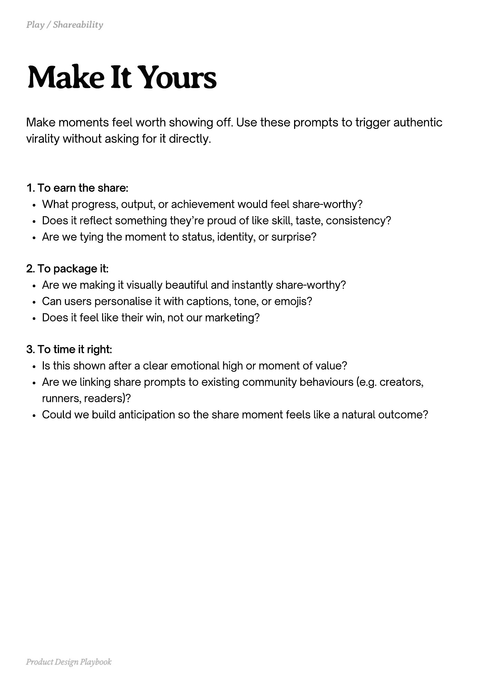

# PDF page 153

Source: `docs/ProductDesignPlaybook_V2.0.pdf`, page 153 of 206.

[Open the full-page screenshot](../../screenshots/page-153.jpg)



## Extracted text

```text
Make moments feel worth showing off. Use these prompts to trigger authentic
virality without asking for it directly.
1. To earn the share:

What progress, output, or achievement would feel share-worthy?

Does it reflect something they’re proud of like skill, taste, consistency?

Are we tying the moment to status, identity, or surprise?


2. To package it:

Are we making it visually beautiful and instantly share-worthy?

Can users personalise it with captions, tone, or emojis?

Does it feel like their win, not our marketing?


3. To time it right:

Is this shown after a clear emotional high or moment of value?

Are we linking share prompts to existing community behaviours (e.g. creators,
runners, readers)?

Could we build anticipation so the share moment feels like a natural outcome?

Product Design Playbook
```
