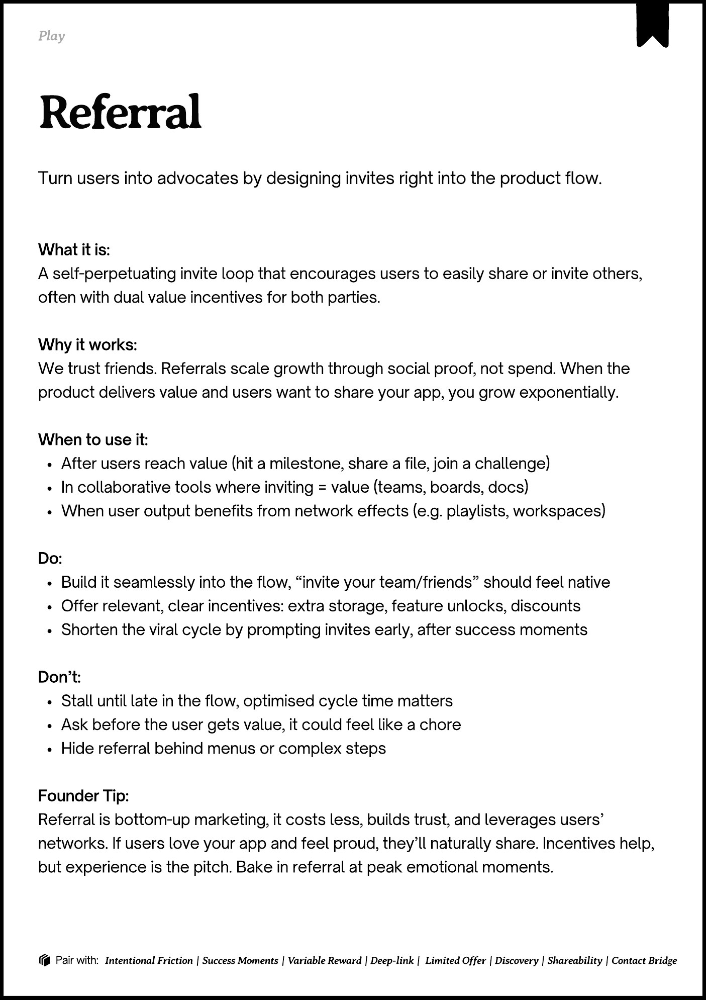

# PDF page 157

Source: `docs/ProductDesignPlaybook_V2.0.pdf`, page 157 of 206.

[Open the full-page screenshot](../../screenshots/page-157.jpg)



## Extracted text

```text
􀉟

lay

Turn users into advocates by designing invites right into the product flow.

What it is:

A self-perpetuating invite loop that encourages users to easily share or invite others,
often with dual value incentives for both parties.


Why it works:

We trust friends. Referrals scale growth through social proof, not spend. When the
product delivers value and users want to share your app, you grow exponentially. 


When to use it:

After users reach value (hit a milestone, share a file, join a challenge)

In collaborative tools where inviting = value (teams, boards, docs)

When user output benefits from network effects (e.g. playlists, workspaces)


Do:

Build it seamlessly into the flow, “invite your team/friends” should feel native

Offer relevant, clear incentives: extra storage, feature unlocks, discounts

Shorten the viral cycle by prompting invites early, after success moments


Don’t:

Stall until late in the flow, optimised cycle time matters

Ask before the user gets value, it could feel like a chore

Hide referral behind menus or complex steps


Founder Tip:

Referral is bottom-up marketing, it costs less, builds trust, and leverages users’
networks. If users love your app and feel proud, they’ll naturally share. Incentives help,
but experience is the pitch. Bake in referral at peak emotional moments.

􀰴 Pair with:

Intentional Friction | Success Moments | Variable Reward | Deep-link |

Limited Offer | Discovery | Shareability | Contact Bridge
```
