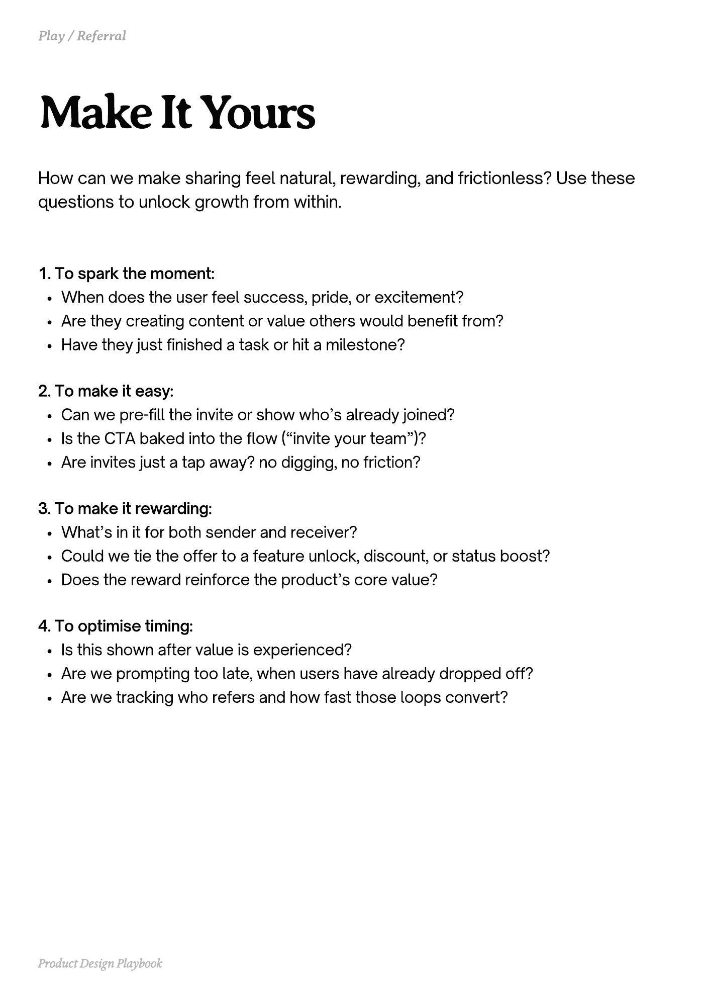

# PDF page 158

Source: `docs/ProductDesignPlaybook_V2.0.pdf`, page 158 of 206.

[Open the full-page screenshot](../../screenshots/page-158.jpg)



## Extracted text

```text
How can we make sharing feel natural, rewarding, and frictionless? Use these
questions to unlock growth from within.
1. To spark the moment:

When does the user feel success, pride, or excitement?

Are they creating content or value others would benefit from?

Have they just finished a task or hit a milestone?


2. To make it easy:

Can we pre-fill the invite or show who’s already joined?

Is the CTA baked into the flow (“invite your team”)?

Are invites just a tap away? no digging, no friction?


3. To make it rewarding:

What’s in it for both sender and receiver?

Could we tie the offer to a feature unlock, discount, or status boost?

Does the reward reinforce the product’s core value?


4. To optimise timing:

Is this shown after value is experienced?

Are we prompting too late, when users have already dropped off?

Are we tracking who refers and how fast those loops convert?

Product Design Playbook
```
