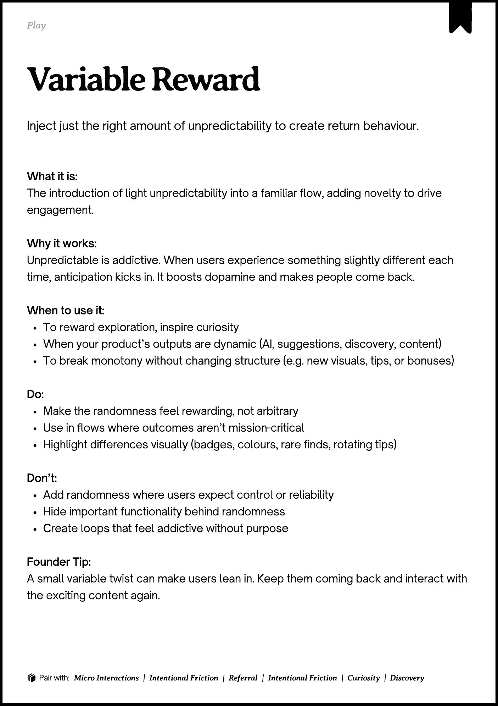

# PDF page 162

Source: `docs/ProductDesignPlaybook_V2.0.pdf`, page 162 of 206.

[Open the full-page screenshot](../../screenshots/page-162.jpg)



## Extracted text

```text
􀉟

lay

Inject just the right amount of unpredictability to create return behaviour.

What it is:

The introduction of light unpredictability into a familiar flow, adding novelty to drive
engagement.


Why it works:

Unpredictable is addictive. When users experience something slightly different each
time, anticipation kicks in. It boosts dopamine and makes people come back.


When to use it:

To reward exploration, inspire curiosity

When your product’s outputs are dynamic (AI, suggestions, discovery, content)

To break monotony without changing structure (e.g. new visuals, tips, or bonuses)


Do:

Make the randomness feel rewarding, not arbitrary

Use in flows where outcomes aren’t mission-critical

Highlight differences visually (badges, colours, rare finds, rotating tips)


Don’t:

Add randomness where users expect control or reliability

Hide important functionality behind randomness

Create loops that feel addictive without purpose


Founder Tip:

A small variable twist can make users lean in. Keep them coming back and interact with
the exciting content again.

􀰴 Pair with:

Micro Interactions

|

Intentional Friction

|

Referral

|

Intentional Friction

| Curiosity | Discovery
```
