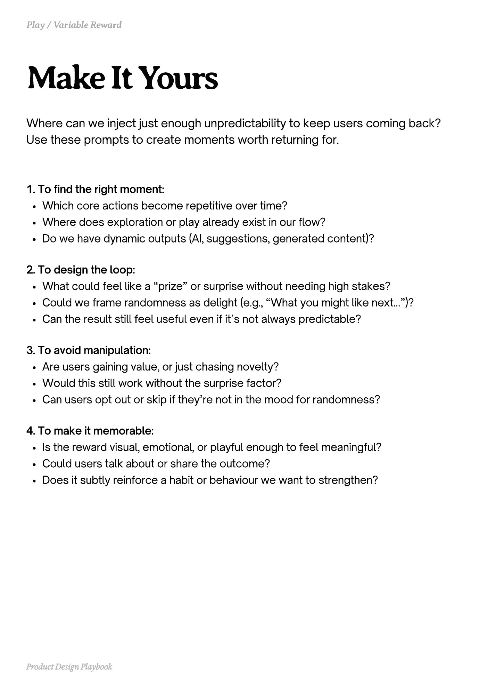

# PDF page 163

Source: `docs/ProductDesignPlaybook_V2.0.pdf`, page 163 of 206.

[Open the full-page screenshot](../../screenshots/page-163.jpg)



## Extracted text

```text
Where can we inject just enough unpredictability to keep users coming back?
Use these prompts to create moments worth returning for.

1. To find the right moment:

Which core actions become repetitive over time?

Where does exploration or play already exist in our flow?

Do we have dynamic outputs (AI, suggestions, generated content)?



2. To design the loop:

What could feel like a “prize” or surprise without needing high stakes?

Could we frame randomness as delight (e.g., “What you might like next…”)?

Can the result still feel useful even if it’s not always predictable?



3. To avoid manipulation:

Are users gaining value, or just chasing novelty?

Would this still work without the surprise factor?

Can users opt out or skip if they’re not in the mood for randomness?



4. To make it memorable:

Is the reward visual, emotional, or playful enough to feel meaningful?

Could users talk about or share the outcome?

Does it subtly reinforce a habit or behaviour we want to strengthen?

Product Design Playbook
```
