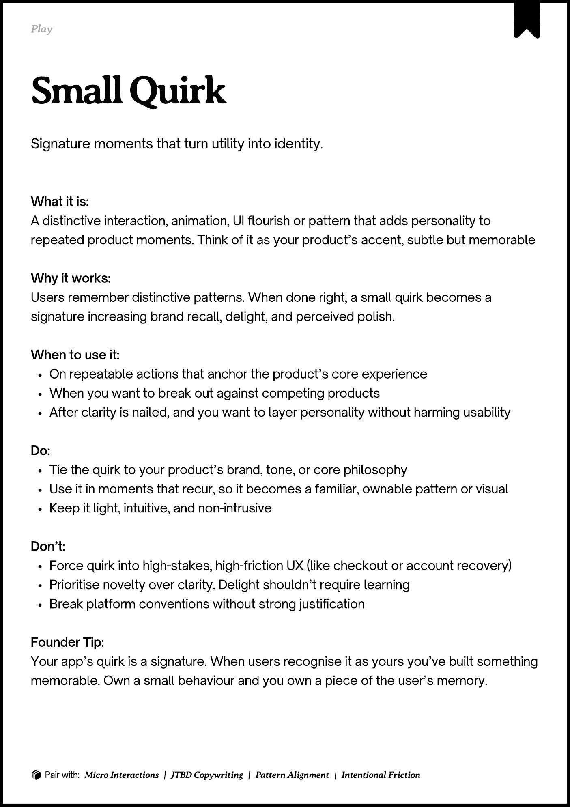

# PDF page 167

Source: `docs/ProductDesignPlaybook_V2.0.pdf`, page 167 of 206.

[Open the full-page screenshot](../../screenshots/page-167.jpg)



## Extracted text

```text
􀉟

Play

Signature moments that turn utility into identity.

What it is:

A distinctive interaction, animation, UI flourish or pattern that adds personality to
repeated product moments. Think of it as your product’s accent, subtle but memorable


Why it works:

Users remember distinctive patterns. When done right, a small quirk becomes a
signature increasing brand recall, delight, and perceived polish.


When to use it:

On repeatable actions that anchor the product’s core experience

When you want to break out against competing products

After clarity is nailed, and you want to layer personality without harming usability


Do:

Tie the quirk to your product’s brand, tone, or core philosophy

Use it in moments that recur, so it becomes a familiar, ownable pattern or visual

Keep it light, intuitive, and non-intrusive


Don’t:

Force quirk into high-stakes, high-friction UX (like checkout or account recovery)

Prioritise novelty over clarity. Delight shouldn’t require learning

Break platform conventions without strong justification


Founder Tip:

Your app’s quirk is a signature. When users recognise it as yours you’ve built something
memorable. Own a small behaviour and you own a piece of the user’s memory.

􀰴 Pair with:

Micro Interactions

|

JTBD Copywriting

|

Pattern Alignment

|

Intentional Friction
```
