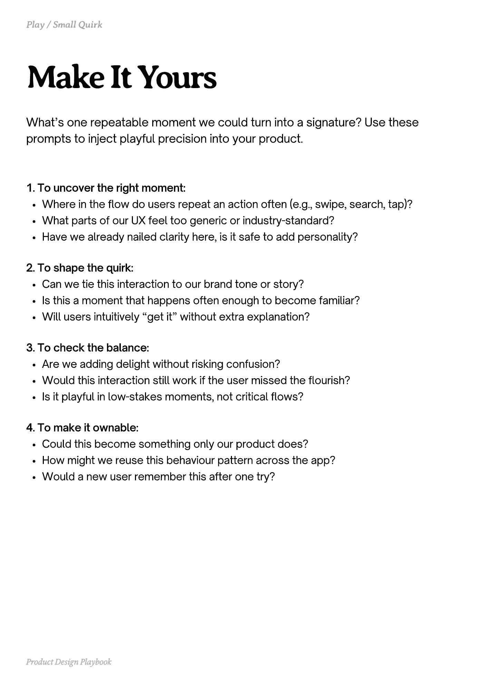

# PDF page 168

Source: `docs/ProductDesignPlaybook_V2.0.pdf`, page 168 of 206.

[Open the full-page screenshot](../../screenshots/page-168.jpg)



## Extracted text

```text
What’s one repeatable moment we could turn into a signature? Use these
prompts to inject playful precision into your product.

1. To uncover the right moment:

Where in the flow do users repeat an action often (e.g., swipe, search, tap)?

What parts of our UX feel too generic or industry-standard?

Have we already nailed clarity here, is it safe to add personality?



2. To shape the quirk:

Can we tie this interaction to our brand tone or story?

Is this a moment that happens often enough to become familiar?

Will users intuitively “get it” without extra explanation?



3. To check the balance:

Are we adding delight without risking confusion?

Would this interaction still work if the user missed the flourish?

Is it playful in low-stakes moments, not critical flows?



4. To make it ownable:

Could this become something only our product does?

How might we reuse this behaviour pattern across the app?

Would a new user remember this after one try?

Product Design Playbook
```
