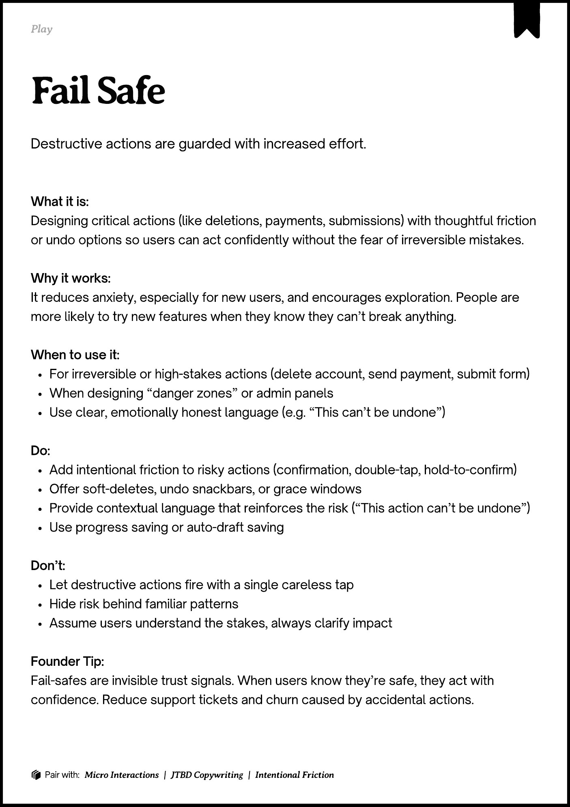

# PDF page 172

Source: `docs/ProductDesignPlaybook_V2.0.pdf`, page 172 of 206.

[Open the full-page screenshot](../../screenshots/page-172.jpg)



## Extracted text

```text
􀉟

lay

Destructive actions are guarded with increased effort.

What it is:

Designing critical actions (like deletions, payments, submissions) with thoughtful friction
or undo options so users can act confidently without the fear of irreversible mistakes.


Why it works:

It reduces anxiety, especially for new users, and encourages exploration. People are
more likely to try new features when they know they can’t break anything.


When to use it:

For irreversible or high-stakes actions (delete account, send payment, submit form)

When designing “danger zones” or admin panels

Use clear, emotionally honest language (e.g. “This can’t be undone”)


Do:

Add intentional friction to risky actions (confirmation, double-tap, hold-to-confirm)

Offer soft-deletes, undo snackbars, or grace windows

Provide contextual language that reinforces the risk (“This action can’t be undone”)

Use progress saving or auto-draft saving


Don’t:

Let destructive actions fire with a single careless tap

Hide risk behind familiar patterns

Assume users understand the stakes, always clarify impact


Founder Tip:

Fail-safes are invisible trust signals. When users know they’re safe, they act with
confidence. Reduce support tickets and churn caused by accidental actions.

􀰴 Pair with:

Micro Interactions

|

JTBD Copywriting

|

Intentional Friction
```
