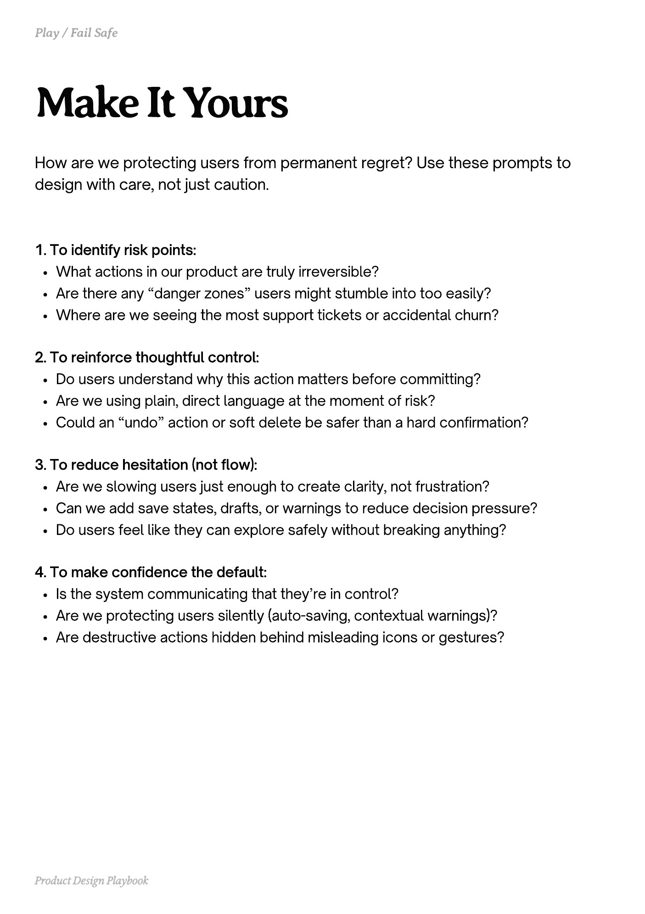

# PDF page 173

Source: `docs/ProductDesignPlaybook_V2.0.pdf`, page 173 of 206.

[Open the full-page screenshot](../../screenshots/page-173.jpg)



## Extracted text

```text
How are we protecting users from permanent regret? Use these prompts to
design with care, not just caution.

1. To identify risk points:

What actions in our product are truly irreversible?

Are there any “danger zones” users might stumble into too easily?

Where are we seeing the most support tickets or accidental churn?



2. To reinforce thoughtful control:

Do users understand why this action matters before committing?

Are we using plain, direct language at the moment of risk?

Could an “undo” action or soft delete be safer than a hard confirmation?


3. To reduce hesitation (not flow):

Are we slowing users just enough to create clarity, not frustration?

Can we add save states, drafts, or warnings to reduce decision pressure?

Do users feel like they can explore safely without breaking anything?



4. To make confidence the default:

Is the system communicating that they’re in control?

Are we protecting users silently (auto-saving, contextual warnings)?

Are destructive actions hidden behind misleading icons or gestures?

Product Design Playbook
```
