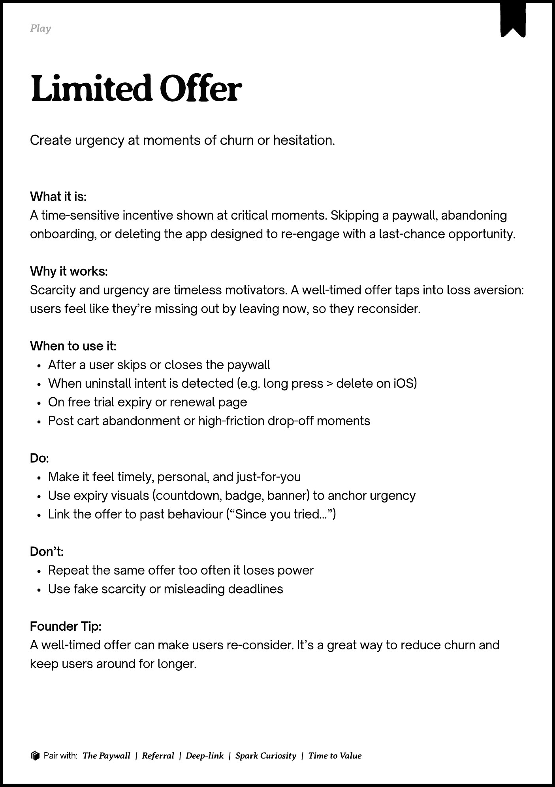

# PDF page 177

Source: `docs/ProductDesignPlaybook_V2.0.pdf`, page 177 of 206.

[Open the full-page screenshot](../../screenshots/page-177.jpg)



## Extracted text

```text
􀉟

Play

Create urgency at moments of churn or hesitation.

What it is:

A time-sensitive incentive shown at critical moments. Skipping a paywall, abandoning
onboarding, or deleting the app designed to re-engage with a last-chance opportunity.


Why it works:

Scarcity and urgency are timeless motivators. A well-timed offer taps into loss aversion:
users feel like they’re missing out by leaving now, so they reconsider.


When to use it:

After a user skips or closes the paywall

When uninstall intent is detected (e.g. long press > delete on iOS)

On free trial expiry or renewal page

Post cart abandonment or high-friction drop-off moments


Do:

Make it feel timely, personal, and just-for-you

Use expiry visuals (countdown, badge, banner) to anchor urgency

Link the offer to past behaviour (“Since you tried...”)


Don’t:

Repeat the same offer too often it loses power

Use fake scarcity or misleading deadlines


Founder Tip:

A well-timed offer can make users re-consider. It’s a great way to reduce churn and
keep users around for longer.

􀰴 Pair with:

The Paywall

|

Referral

| Deep-link |

Spark Curiosity

|

Time to Value
```
