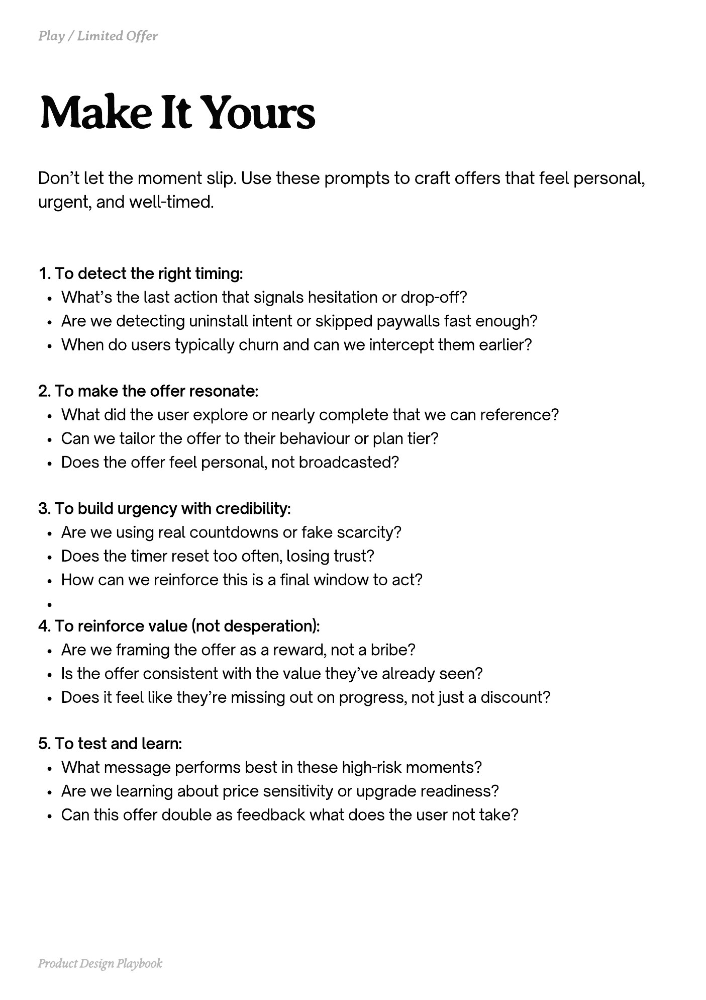

# PDF page 178

Source: `docs/ProductDesignPlaybook_V2.0.pdf`, page 178 of 206.

[Open the full-page screenshot](../../screenshots/page-178.jpg)



## Extracted text

```text
Don’t let the moment slip. Use these prompts to craft offers that feel personal,
urgent, and well-timed.

1. To detect the right timing:

What’s the last action that signals hesitation or drop-off?

Are we detecting uninstall intent or skipped paywalls fast enough?

When do users typically churn and can we intercept them earlier?



2. To make the offer resonate:

What did the user explore or nearly complete that we can reference?

Can we tailor the offer to their behaviour or plan tier?

Does the offer feel personal, not broadcasted?



3. To build urgency with credibility:

Are we using real countdowns or fake scarcity?

Does the timer reset too often, losing trust?

How can we reinforce this is a final window to act?


4. To reinforce value (not desperation):

Are we framing the offer as a reward, not a bribe?

Is the offer consistent with the value they’ve already seen?

Does it feel like they’re missing out on progress, not just a discount?



5. To test and learn:

What message performs best in these high-risk moments?

Are we learning about price sensitivity or upgrade readiness?

Can this offer double as feedback what does the user not take?

Product Design Playbook
```
