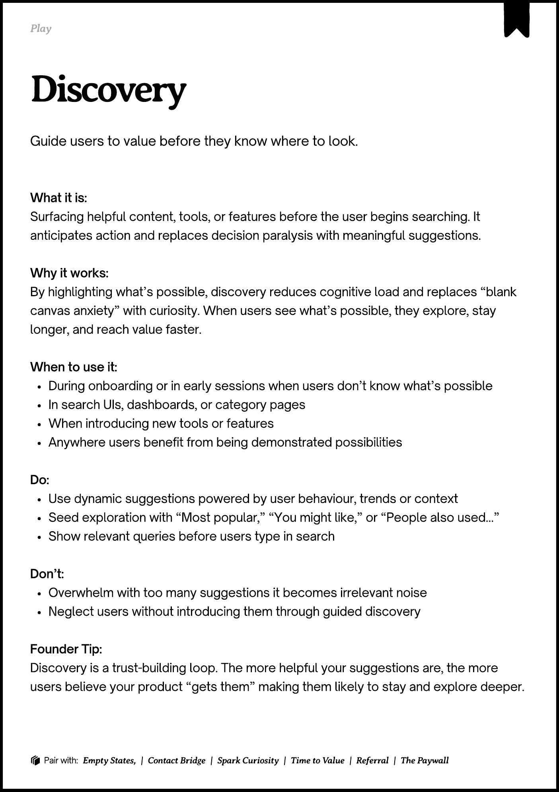

# PDF page 182

Source: `docs/ProductDesignPlaybook_V2.0.pdf`, page 182 of 206.

[Open the full-page screenshot](../../screenshots/page-182.jpg)



## Extracted text

```text
􀉟

Play

Guide users to value before they know where to look.

What it is:

Surfacing helpful content, tools, or features before the user begins searching. It
anticipates action and replaces decision paralysis with meaningful suggestions.


Why it works:

By highlighting what’s possible, discovery reduces cognitive load and replaces “blank
canvas anxiety” with curiosity. When users see what’s possible, they explore, stay
longer, and reach value faster.


When to use it:

During onboarding or in early sessions when users don’t know what’s possible

In search UIs, dashboards, or category pages

When introducing new tools or features

Anywhere users benefit from being demonstrated possibilities


Do:

Use dynamic suggestions powered by user behaviour, trends or context

Seed exploration with “Most popular,” “You might like,” or “People also used…”

Show relevant queries before users type in search


Don’t:

Overwhelm with too many suggestions it becomes irrelevant noise

Neglect users without introducing them through guided discovery 


Founder Tip:

Discovery is a trust-building loop. The more helpful your suggestions are, the more
users believe your product “gets them” making them likely to stay and explore deeper.

􀰴 Pair with:

Empty States, |

Contact Bridge

|

Spark Curiosity

|

Time to Value

|

Referral

|

The Paywall
```
