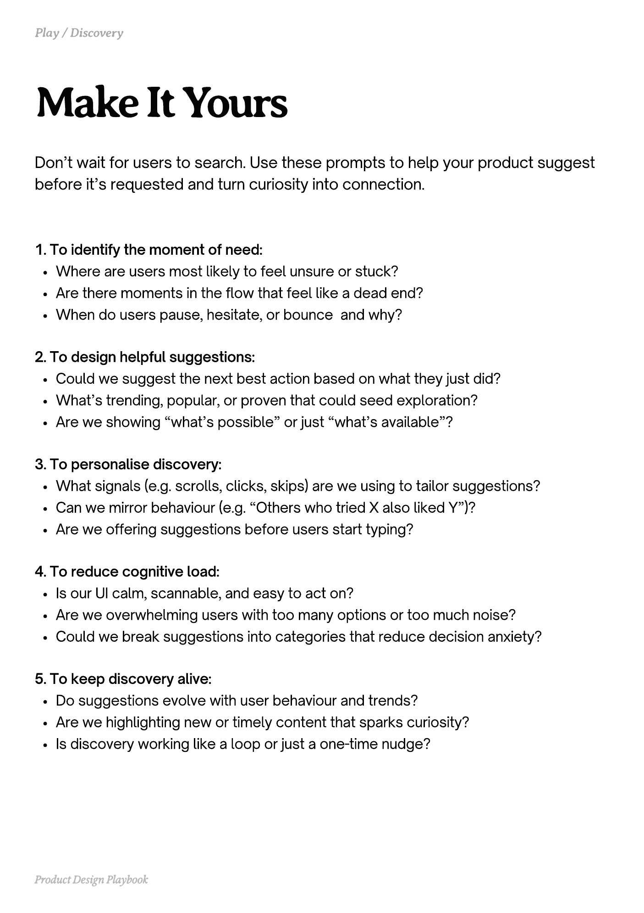

# PDF page 183

Source: `docs/ProductDesignPlaybook_V2.0.pdf`, page 183 of 206.

[Open the full-page screenshot](../../screenshots/page-183.jpg)



## Extracted text

```text
Don’t wait for users to search. Use these prompts to help your product suggest
before it’s requested and turn curiosity into connection.
1. To identify the moment of need:

Where are users most likely to feel unsure or stuck?

Are there moments in the flow that feel like a dead end?

When do users pause, hesitate, or bounce and why?


2. To design helpful suggestions:

Could we suggest the next best action based on what they just did?

What’s trending, popular, or proven that could seed exploration?

Are we showing “what’s possible” or just “what’s available”?


3. To personalise discovery:

What signals (e.g. scrolls, clicks, skips) are we using to tailor suggestions?

Can we mirror behaviour (e.g. “Others who tried X also liked Y”)?

Are we offering suggestions before users start typing?


4. To reduce cognitive load:

Is our UI calm, scannable, and easy to act on?

Are we overwhelming users with too many options or too much noise?

Could we break suggestions into categories that reduce decision anxiety?


5. To keep discovery alive:

Do suggestions evolve with user behaviour and trends?

Are we highlighting new or timely content that sparks curiosity?

Is discovery working like a loop or just a one-time nudge?

Product Design Playbook
```
