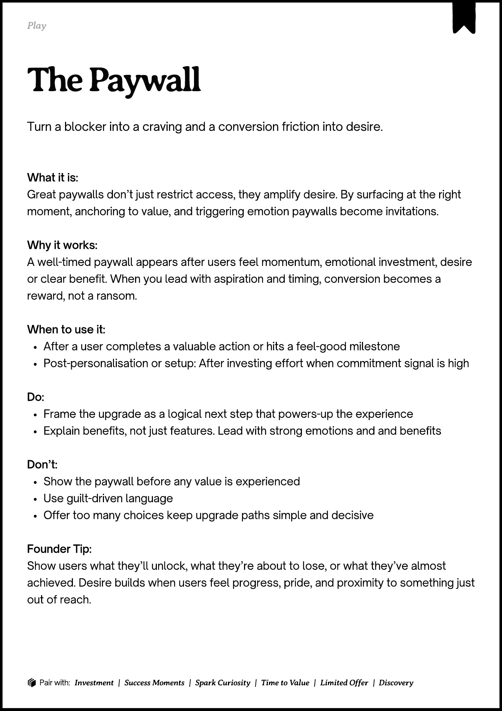

# PDF page 187

Source: `docs/ProductDesignPlaybook_V2.0.pdf`, page 187 of 206.

[Open the full-page screenshot](../../screenshots/page-187.jpg)



## Extracted text

```text
􀉟

lay

Turn a blocker into a craving and a conversion friction into desire.

What it is:

Great paywalls don’t just restrict access, they amplify desire. By surfacing at the right
moment, anchoring to value, and triggering emotion paywalls become invitations.


Why it works:

A well-timed paywall appears after users feel momentum, emotional investment, desire
or clear benefit. When you lead with aspiration and timing, conversion becomes a
reward, not a ransom.


When to use it:

After a user completes a valuable action or hits a feel-good milestone

Post-personalisation or setup: After investing effort when commitment signal is high



Do:

Frame the upgrade as a logical next step that powers-up the experience 

Explain benefits, not just features. Lead with strong emotions and and benefits


Don’t:

Show the paywall before any value is experienced

Use guilt-driven language

Offer too many choices keep upgrade paths simple and decisive


Founder Tip:

Show users what they’ll unlock, what they’re about to lose, or what they’ve almost
achieved. Desire builds when users feel progress, pride, and proximity to something just
out of reach.

􀰴 Pair with:

Investment

|

Success Moments

|

Spark Curiosity

|

Time to Value

|

Limited Offer

| Discovery
```
