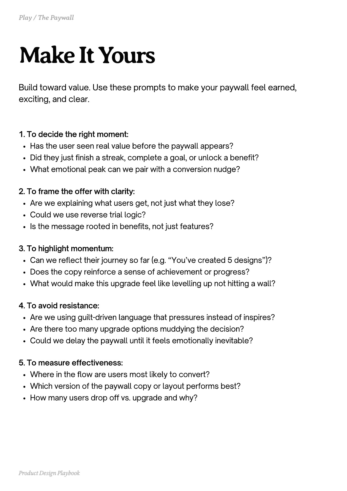

# PDF page 188

Source: `docs/ProductDesignPlaybook_V2.0.pdf`, page 188 of 206.

[Open the full-page screenshot](../../screenshots/page-188.jpg)



## Extracted text

```text
Build toward value. Use these prompts to make your paywall feel earned,
exciting, and clear.
1. To decide the right moment:

Has the user seen real value before the paywall appears?

Did they just finish a streak, complete a goal, or unlock a benefit?

What emotional peak can we pair with a conversion nudge?


2. To frame the offer with clarity:

Are we explaining what users get, not just what they lose?

Could we use reverse trial logic?

Is the message rooted in benefits, not just features?


3. To highlight momentum:

Can we reflect their journey so far (e.g. “You’ve created 5 designs”)?

Does the copy reinforce a sense of achievement or progress?

What would make this upgrade feel like levelling up not hitting a wall?


4. To avoid resistance:

Are we using guilt-driven language that pressures instead of inspires?

Are there too many upgrade options muddying the decision?

Could we delay the paywall until it feels emotionally inevitable?


5. To measure effectiveness:

Where in the flow are users most likely to convert?

Which version of the paywall copy or layout performs best?

How many users drop off vs. upgrade and why?

Product Design Playbook
```
