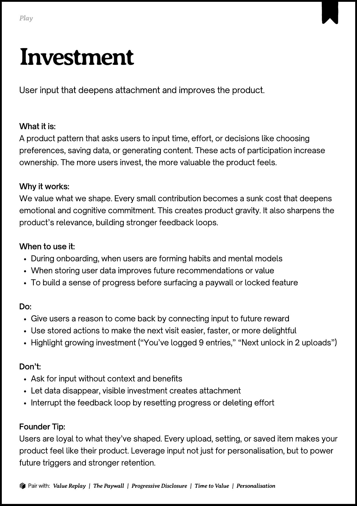

# PDF page 192

Source: `docs/ProductDesignPlaybook_V2.0.pdf`, page 192 of 206.

[Open the full-page screenshot](../../screenshots/page-192.jpg)



## Extracted text

```text
􀉟

Play

User input that deepens attachment and improves the product.

What it is:

A product pattern that asks users to input time, effort, or decisions like choosing
preferences, saving data, or generating content. These acts of participation increase
ownership. The more users invest, the more valuable the product feels.


Why it works:

We value what we shape. Every small contribution becomes a sunk cost that deepens
emotional and cognitive commitment. This creates product gravity. It also sharpens the
product’s relevance, building stronger feedback loops.


When to use it:

During onboarding, when users are forming habits and mental models

When storing user data improves future recommendations or value

To build a sense of progress before surfacing a paywall or locked feature


Do:

Give users a reason to come back by connecting input to future reward

Use stored actions to make the next visit easier, faster, or more delightful

Highlight growing investment (“You’ve logged 9 entries,” “Next unlock in 2 uploads”)


Don’t:

Ask for input without context and benefits

Let data disappear, visible investment creates attachment

Interrupt the feedback loop by resetting progress or deleting effort


Founder Tip:

Users are loyal to what they’ve shaped. Every upload, setting, or saved item makes your
product feel like their product. Leverage input not just for personalisation, but to power
future triggers and stronger retention.

􀰴 Pair with:

Value Replay

|

The Paywall

|

Progressive Disclosure

|

Time to Value

| Personalisation
```
