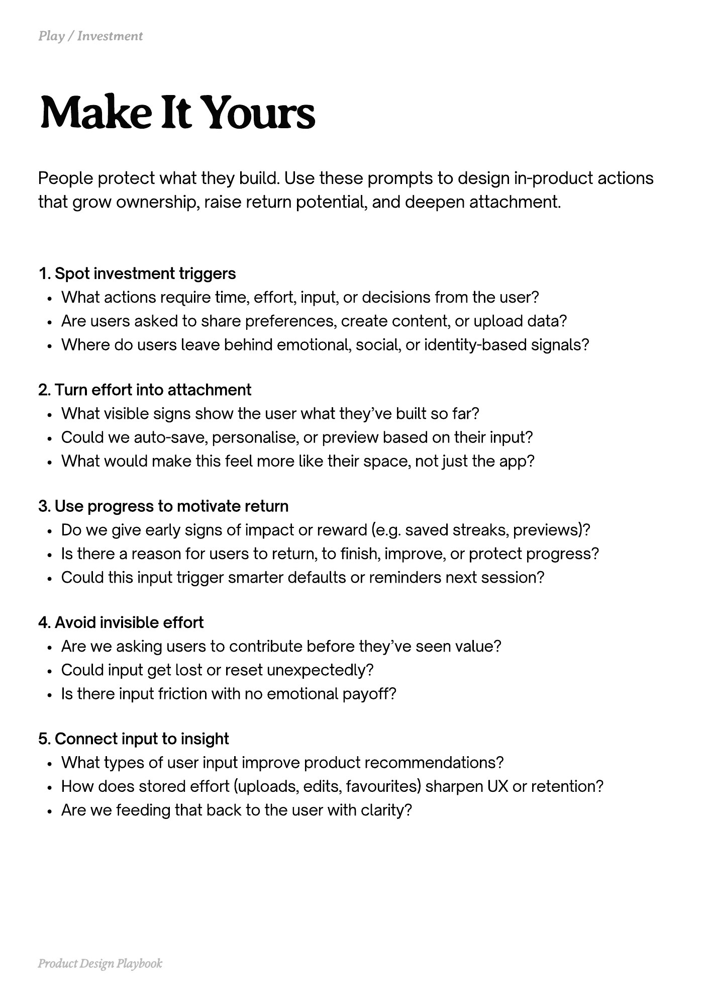

# PDF page 193

Source: `docs/ProductDesignPlaybook_V2.0.pdf`, page 193 of 206.

[Open the full-page screenshot](../../screenshots/page-193.jpg)



## Extracted text

```text
People protect what they build. Use these prompts to design in-product actions
that grow ownership, raise return potential, and deepen attachment.

1. Spot investment triggers

What actions require time, effort, input, or decisions from the user?

Are users asked to share preferences, create content, or upload data?

Where do users leave behind emotional, social, or identity-based signals?



2. Turn effort into attachment

What visible signs show the user what they’ve built so far?

Could we auto-save, personalise, or preview based on their input?

What would make this feel more like their space, not just the app?



3. Use progress to motivate return

Do we give early signs of impact or reward (e.g. saved streaks, previews)?

Is there a reason for users to return, to finish, improve, or protect progress?

Could this input trigger smarter defaults or reminders next session?



4. Avoid invisible effort

Are we asking users to contribute before they’ve seen value?

Could input get lost or reset unexpectedly?

Is there input friction with no emotional payoff?



5. Connect input to insight

What types of user input improve product recommendations?

How does stored effort (uploads, edits, favourites) sharpen UX or retention?

Are we feeding that back to the user with clarity?

Product Design Playbook
```
