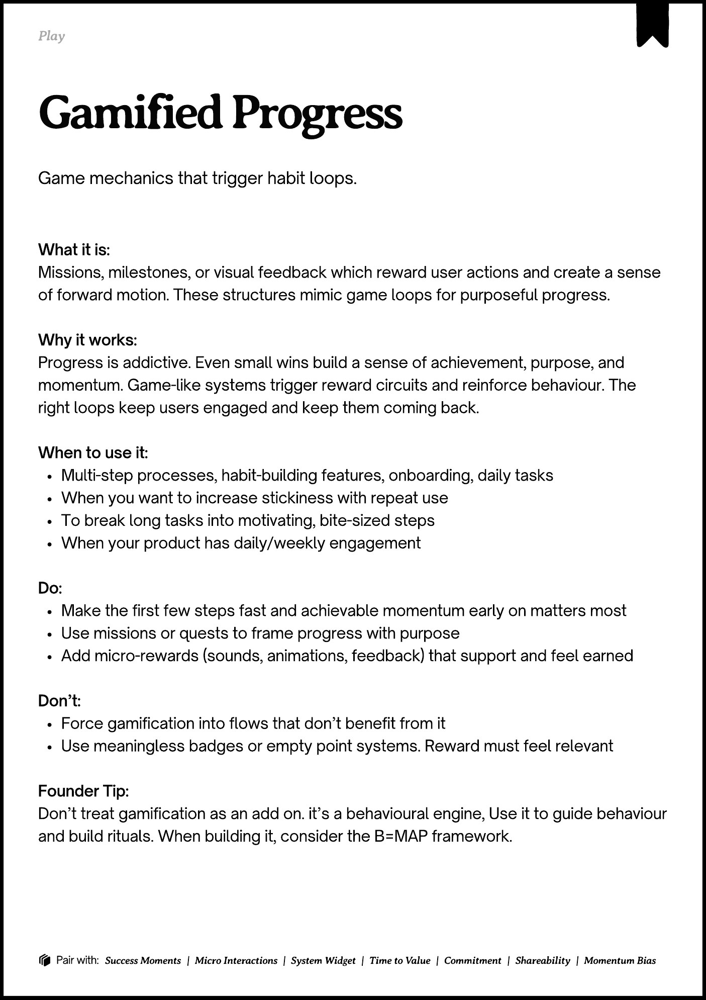

# PDF page 197

Source: `docs/ProductDesignPlaybook_V2.0.pdf`, page 197 of 206.

[Open the full-page screenshot](../../screenshots/page-197.jpg)



## Extracted text

```text
􀉟

lay

Game mechanics that trigger habit loops.

What it is:

Missions, milestones, or visual feedback which reward user actions and create a sense
of forward motion. These structures mimic game loops for purposeful progress.


Why it works:

Progress is addictive. Even small wins build a sense of achievement, purpose, and
momentum. Game-like systems trigger reward circuits and reinforce behaviour. The
right loops keep users engaged and keep them coming back.


When to use it:

Multi-step processes, habit-building features, onboarding, daily tasks

When you want to increase stickiness with repeat use

To break long tasks into motivating, bite-sized steps

When your product has daily/weekly engagement


Do:

Make the first few steps fast and achievable momentum early on matters most

Use missions or quests to frame progress with purpose

Add micro-rewards (sounds, animations, feedback) that support and feel earned


Don’t:

Force gamification into flows that don’t benefit from it

Use meaningless badges or empty point systems. Reward must feel relevant


Founder Tip:

Don’t treat gamification as an add on. it’s a behavioural engine, Use it to guide behaviour
and build rituals. When building it, consider the B=MAP framework.

􀰴 Pair with:

Success Moments

|

Micro Interactions

|

System Widget

|

Time to Value

|

Commitment

|

Shareability

|

Momentum Bias
```
