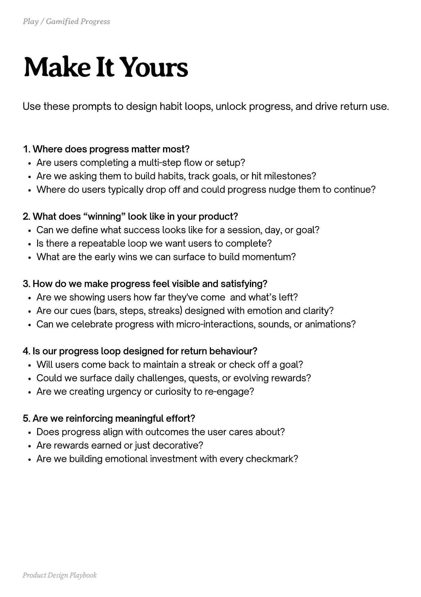

# PDF page 198

Source: `docs/ProductDesignPlaybook_V2.0.pdf`, page 198 of 206.

[Open the full-page screenshot](../../screenshots/page-198.jpg)



## Extracted text

```text
Use these prompts to design habit loops, unlock progress, and drive return use.

1. Where does progress matter most?

Are users completing a multi-step flow or setup?

Are we asking them to build habits, track goals, or hit milestones?

Where do users typically drop off and could progress nudge them to continue?



2. What does “winning” look like in your product?

Can we define what success looks like for a session, day, or goal?

Is there a repeatable loop we want users to complete?

What are the early wins we can surface to build momentum?



3. How do we make progress feel visible and satisfying?

Are we showing users how far they've come

and what’s left?


Are our cues (bars, steps, streaks) designed with emotion and clarity?

Can we celebrate progress with micro-interactions, sounds, or animations?



4. Is our progress loop designed for return behaviour?

Will users come back to maintain a streak or check off a goal?

Could we surface daily challenges, quests, or evolving rewards?

Are we creating urgency or curiosity to re-engage?



5. Are we reinforcing meaningful effort?

Does progress align with outcomes the user cares about?

Are rewards earned or just decorative?

Are we building emotional investment with every checkmark?

Product Design Playbook
```
